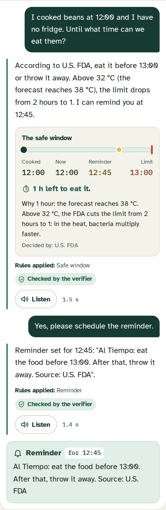
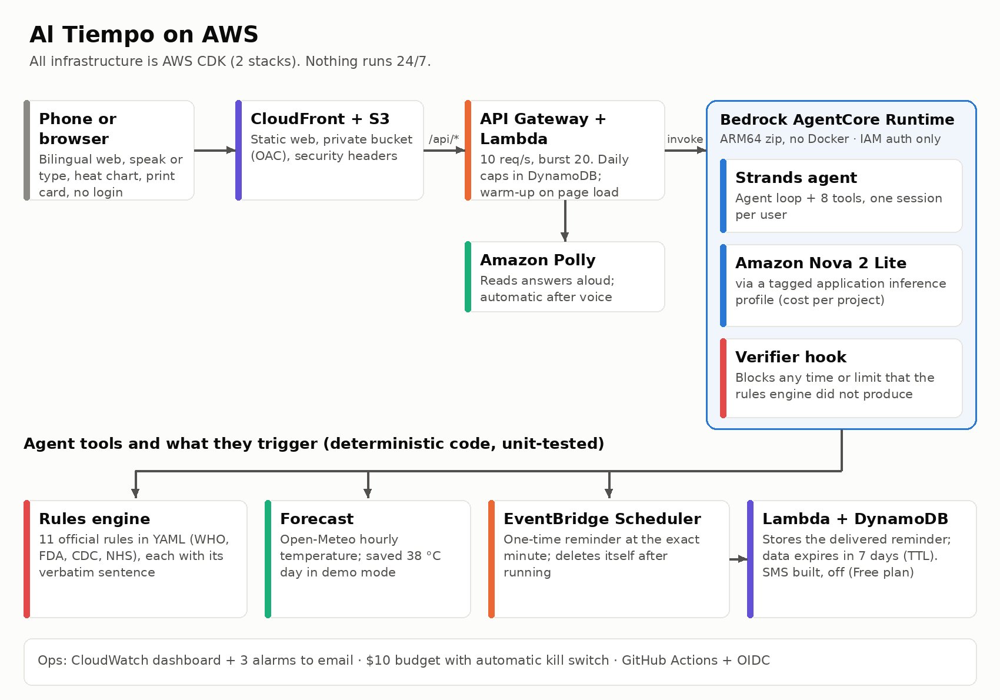

# Al Tiempo — food safety for when the cold runs out

[](https://github.com/Josegas/Al-Tiempo-Food-safety-for-when-the-cold-runs-out/actions/workflows/ci.yml)


An AI agent built with the **Strands Agents SDK** on **AWS** that tells families without reliable
refrigeration — and shelters / community kitchens after disasters — **until what time cooked food
is safe to eat today**, based on official food-safety rules and the hourly heat forecast.

**Focus area: Health** (preventing foodborne illness). Heat, power outages and disasters are the risk factors and the context of use.

> **Design principle:** the model talks and explains; official rules decide; when in doubt, the safest option.
> The LLM never computes times or limits: a deterministic, tested rules engine does, and a verifier hook
> blocks any answer whose times don't match the engine.

## Try it in 1 minute
**Live demo (no login, works on phones): https://d2mnz1h4b0sg0y.cloudfront.net**
Tap a scenario button. The **Simulated** mode (the default, for the demo) uses a saved 38 °C day with the clock at 12:00, and reminders arrive in about 1 minute. Switch to **Live** to use your real time and, if you allow it, the forecast for your location.



Locally (Python 3.11+, AWS credentials with Bedrock access):
```bash
git clone https://github.com/Josegas/Al-Tiempo-Food-safety-for-when-the-cold-runs-out.git
cd Al-Tiempo-Food-safety-for-when-the-cold-runs-out
make install          # venv + dependencies
cp .env.example .env  # DEMO_MODE=true uses a saved 38 °C forecast
make check            # lint + rules policy + tests
make chat             # chat in Spanish (make chat CHAT_LANG=en for English)
make web              # preview the web at http://localhost:8088 (API calls go to the live demo)
make loadtest         # burst test of the live API throttle (health endpoint only, no model calls)
```

## What it does
1. **Safe window + reminders** — "I cooked beans at 12:00" → "According to the U.S. FDA, eat them before 13:00 or throw them away" (38 °C day → 1-hour rule).
2. **Meal planning** — when to cook and how much, so nothing sits out.
3. **Power-outage mode** — fridge/freezer clock from the moment the power went out.
4. **Strict mode for babies and young children.**
5. **Shelters & community kitchens** — staggered cooking batches with discard times.
6. **Danger-sign escalation** — fixed WHO dehydration questions → "go to a clinic / call 911". No diagnosis, no doses.

Every safe-window answer also shows a **timeline** (cooked → now → reminder → limit) drawn only from
the rules engine's numbers. The web is **installable and opens without signal**: offline, it shows
the basic official rules instead of an error.

## How it works


| Piece | Where |
|---|---|
| Rules as data (each with official source) | `rules/food_rules.yaml`, `rules/danger_signs.yaml` |
| Deterministic rules engine (pure Python, tested) | `agent/rules_engine.py` |
| Strands tools (one per file) | `agent/tools/` |
| Verifier hook (`AfterToolCallEvent` + `AfterModelCallEvent`, retry → safe template) | `agent/hooks/verifier.py` |
| AgentCore Runtime entrypoint (structured logs: latency, tokens, verifier blocks) | `agent/app.py` |
| Forecast: Open-Meteo, or fixtures in simulated (demo) mode | `agent/forecast.py`, `fixtures/` |

## Deploy to your AWS account
Infrastructure is AWS CDK (Python) in `infra/`, two stacks: **AlTiempoAccess** (least-privilege
developer user, GitHub OIDC deploy role, project budget + alarms) and **AlTiempoApp** (AgentCore
Runtime, API, reminders, web). Step by step: [`docs/devops.md`](docs/devops.md).
```bash
make deploy-access   # admin, once (review & approve IAM changes)
make dev-profile     # admin, once: least-privilege CLI profile "al-tiempo"
make deploy          # package the agent (ARM64 zip, no Docker) + cdk deploy
make smoke           # end-to-end check of the live demo
```

## Engineering practices
- **CI (GitHub Actions):** ruff lint/format, pytest + coverage summary, rules policy check; `cdk synth` on PRs.
- **CD:** every merge to `main` deploys with GitHub Actions + **OIDC** (no stored AWS keys) and runs a smoke test.
- **Least privilege & FinOps:** per-project IAM user without admin rights, tagged budget with a
  **kill switch** (AWS Budgets action), throttling and a daily cap.
- **Security:** gitleaks secret scan, pip-audit dependency scan, bandit-style static rules, Dependabot.
- **Policy as code:** a release (`v*` tag) is blocked while any food rule is not verified on its official source.
- **Safety regression tests:** every real unsafe answer we found becomes a test (see `docs/diario.md`).
- **Evals drive decisions:** 18 bilingual scenarios picked the model (Nova Lite 8/18, Nova Pro
  15/18, **Nova 2 Lite 18/18**). The suite now has **50 scenarios** (incl. 15 adversarial) and passes
  **99/100** over two runs at $0.00227 per turn, with 0 unsafe answers (`docs/metrics.md`,
  `docs/costs.md`). Every number we publish is in `docs/sources.md`.
- **Load-tested guardrails:** `make loadtest` shows normal traffic answered and bursts stopped
  before they reach the model (`docs/costs.md`).

## Rule sources (all verified on 2026-11-03)
Every rule in `rules/food_rules.yaml` stores the **verbatim sentence** from its official page
(`verified_text`) so anyone can check it with Ctrl+F. Sources: WHO *Five keys to safer food*,
U.S. FDA, CDC (infant formula), NHS (cooked rice). One rule is marked `adapted` (rice without a
fridge) and one is a `policy` (stricter mode for young children); both say so to the user.
CI blocks a release if any rule is unverified (`python scripts/check_rules.py --strict`).

## Disclaimer
Al Tiempo gives general food-safety guidance from public health sources. It is not medical advice.
In an emergency, call your local emergency number.

## Third-party data and terms
- Weather data by [Open-Meteo.com](https://open-meteo.com/), licensed [CC BY 4.0](https://creativecommons.org/licenses/by/4.0/); used through the free, non-commercial API (no ads, no subscriptions). The simulated (demo) mode uses saved forecasts.
- Fonts: Fraunces, Atkinson Hyperlegible (subset with a zero without the slash, renamed "AlTiempo Text") and IBM Plex Mono (subset, renamed "AlTiempo Mono"), all SIL Open Font License 1.1, self-hosted in `web/fonts/` with their licenses. Icons are original.
- Food-safety rules are paraphrased and cited; `rules/food_rules.yaml` keeps one short verbatim sentence per rule only so anyone can verify it on the official page. No third-party logos are used.

## License
[MIT](LICENSE)
