# Al Tiempo: un agente de IA que les dice a familias y albergues sin refrigeración hasta qué hora es seguro comer la comida cocinada

> Versión en español del artículo. La versión oficial para el hackathon es la de inglés ([article.md](article.md)); las cifras son las mismas.

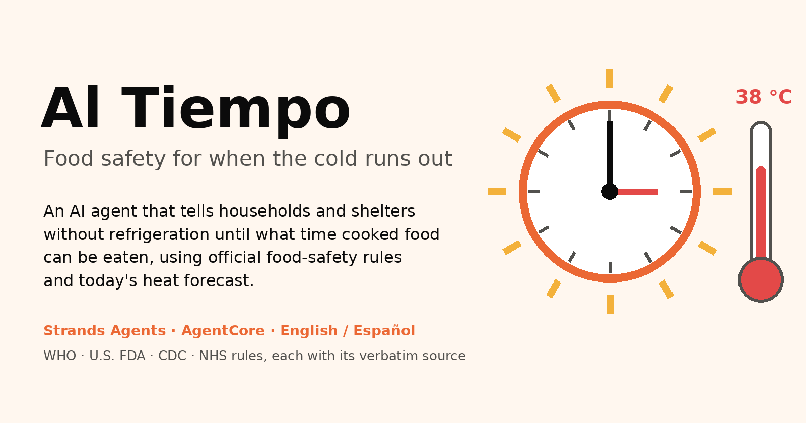

**En un minuto:** Al Tiempo es un agente bilingüe (inglés/español) hecho con el **Strands Agents SDK** que corre en **Amazon Bedrock AgentCore Runtime**. Le dices qué cocinaste y a qué hora, y te responde con una hora del reloj, por ejemplo *"cómete los frijoles antes de las 13:00 o tíralos"*. La respuesta sale de reglas oficiales de inocuidad de los alimentos (OMS, FDA de EE. UU., CDC, NHS) y del pronóstico de calor por hora del día. También puede programar un recordatorio para ese minuto exacto. El modelo de lenguaje nunca calcula una hora: lo hace un motor de reglas con pruebas, y un hook verificador bloquea cualquier respuesta cuyas horas no coincidan con él.

**Área de enfoque: Salud** (prevenir enfermedades transmitidas por alimentos). El calor, los apagones y los desastres son los factores de riesgo y el contexto de uso, no una segunda área.

| Criterio de evaluación | Evidencia en números |
|---|---|
| **Impacto social** | Hecho para los **339 millones de pobres rurales y 746 millones de pobres urbanos** en alto riesgo por falta de enfriamiento, y para los **655 millones** de personas sin electricidad. **11 de 11** reglas verificadas palabra por palabra en fuentes oficiales. |
| **Ejecución técnica** | En vivo en AWS. **141** pruebas automáticas. **99 de 100** ejecuciones de evals de punta a punta aprobadas (50 escenarios bilingües × 2), y la única falla no fue insegura. **8 de 8** horas inventadas bloqueadas por el verificador. **9 de 9** recordatorios en vivo entregados en menos de un minuto después de la hora programada. |
| **Comunicación** | Demo sin login, botones para 7 escenarios listos, respuestas por voz y diseño pensado primero para celular. Cada número de este artículo tiene un enlace a una fuente pública. |
| **Originalidad** | Aplica reglas oficiales al **pronóstico por hora**; recordatorios a futuro con **EventBridge Scheduler**; un **planificador de tandas para albergues**; **modo apagón**; un **hook verificador** que revisa al modelo contra código determinista. |

---

## El problema

*Imagina a una mamá en una casa sin refrigerador, una tarde de 38 °C. A las 9:00 cocinó arroz y frijoles para todo el día. A las 14:00 su hijo de dos años tiene hambre. ¿El arroz todavía está bien?*

No tiene refrigerador, ni termómetro, ni tiempo para buscar guías. Si se equivoca, quien lo paga es su hijo. Y el calor lo empeora.

- **866 millones de personas se enferman y 1.52 millones mueren cada año** por comer alimentos contaminados. Los menores de 5 años cargan el **29%** de ese daño, con **143 000 muertes en 2021** ([hoja informativa de la OMS sobre inocuidad de los alimentos, 4 de junio de 2026](https://www.who.int/news-room/fact-sheets/detail/food-safety)).
- El calor importa. En 10 poblaciones europeas, los casos reportados de salmonelosis aumentaron **de forma lineal con la temperatura por encima de 6 °C** ([Kovats et al., 2004](https://pmc.ncbi.nlm.nih.gov/articles/PMC2870124)).
- La refrigeración no llega a todos:
  - **655 millones** de personas no tenían electricidad en 2024, y el **88.8%** vive en África ([Tracking SDG7 2026, SEforALL](https://www.seforall.org/system/files/2026-07/SEforALL%20Tracking%20SDG7%20-%20The%20Energy%20Progress%20Report%202026_Executive%20Version_22Jul2026-2.pdf)).
  - En 77 países expuestos al calor, **339 millones de pobres rurales y 746 millones de pobres urbanos** están en alto riesgo de no tener enfriamiento adecuado ([Chilling Prospects 2026, vía UNEP Cool Coalition](https://coolcoalition.org/news/chilling-prospects-2026-links-rising-heat-mortality-persistent-cooling-access-gaps)).
- En la India rural, según reportó The Tribune con datos de la encuesta NFHS-5, el **25.2%** de los hogares tiene refrigerador, pero el **91.5%** tiene celular ([The Tribune, mayo de 2022](https://www.tribuneindia.com/news/mobile-most-owned-item-survey-393691)). El celular es el eslabón que le falta a la cadena de frío.

Las reglas existen. La OMS dice que no hay que dejar la comida cocinada más de 2 horas a temperatura ambiente, y la FDA lo baja a 1 hora por encima de 90 °F (32 °C). Pero nadie las convierte en *"cómelo antes de las 13:00 de hoy"* para una familia sin refrigerador.

## Pruébalo en 1 minuto

- **Demo en vivo (sin login):** https://d2mnz1h4b0sg0y.cloudfront.net
- **Código (licencia MIT):** https://github.com/Josegas/Al-Tiempo-Food-safety-for-when-the-cold-runs-out
- **Video (< 3 min):** [TODO: enlace de YouTube]

1. Abre la demo en tu celular y elige **English** o **Español**.
2. Toca **Ventana segura**. La página empieza en modo **Simulado**: un día guardado de 38 °C y un reloj fijo a las 12:00, para que todos vean el mismo resultado. La respuesta es *"Según U.S. FDA, cómelo antes de las 13:00 o deséchalo. Con más de 32 °C (el pronóstico llega a 38 °C), el límite baja de 2 horas a 1. Puedo recordártelo a las 12:45."*
3. Toca **Recordatorio**. En modo Simulado el reloj va acelerado, así que el recordatorio llega en más o menos **1 minuto** en lugar de 45.
4. Prueba **Albergue (120 personas)**, **Apagón** y **Señales de alarma**. Toca **🔊 Escuchar** para oír cualquier respuesta.
5. Cambia al modo **Real** para usar tu ubicación real (redondeada a 1 km aproximadamente) y el pronóstico real por hora.

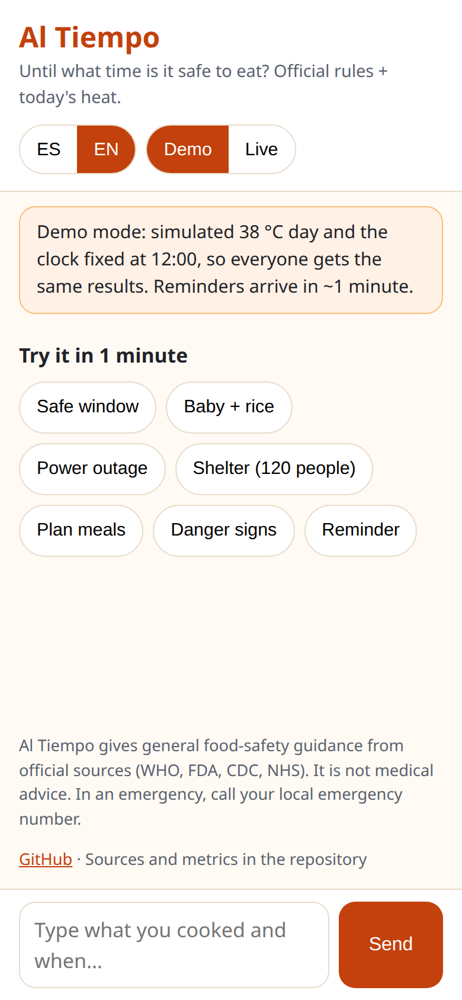

## Qué hace

Cada respuesta de abajo es una **respuesta real de la demo en vivo** (día de 38 °C, reloj a las 12:00). Las conversaciones se hicieron en inglés y aquí están traducidas; las capturas son las mismas conversaciones en un celular. `[...]` marca dónde recortamos.

### 1. Ventana segura + recordatorios (el núcleo)
> **Usuario:** Cociné frijoles a las 12:00 y no tengo refrigerador. ¿Hasta qué hora nos los podemos comer?
> **Al Tiempo:** Según la FDA de EE. UU., cómelo antes de las **13:00** o deséchalo. Si quieres, te lo recuerdo a las **12:45**.
> **Usuario:** Sí, por favor programa el recordatorio.
> **Al Tiempo:** Según la FDA de EE. UU., cómelo antes de las **13:00** o deséchalo. Programé un recordatorio para las **12:45**.
> ⏰ **Recordatorio (12:45):** Al Tiempo: come la comida antes de las 13:00. Después, deséchala. Fuente: U.S. FDA

Si el usuario acepta, **Amazon EventBridge Scheduler** crea una programación de una sola vez para ese minuto exacto, que se borra sola al ejecutarse. El recordatorio llega a la web, y el SMS es opcional. La hora y el texto del recordatorio se arman en código a partir del resultado del motor de reglas: *"Al Tiempo: come la comida antes de las 13:00. Después, deséchala. Fuente: U.S. FDA"*.

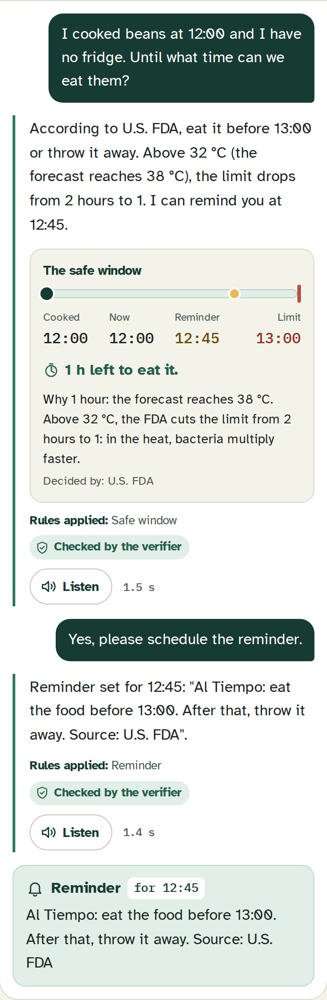

Cada respuesta de ventana segura también dice **por qué**, en una frase armada en código: *"Con más de 32 °C (el pronóstico llega a 38 °C), el límite baja de 2 horas a 1."* Debajo, la web dibuja una **línea de tiempo**: cocinado → ahora → recordatorio → límite, con los minutos que quedan, la razón y la regla que decidió. Se dibuja solo con los números del motor de reglas, que la API devuelve junto al texto. Nunca lee horas de lo que escribió el modelo.

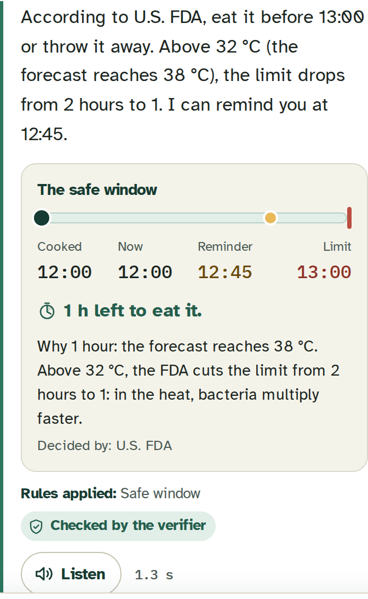

**¿Sin señal? Igual ayuda.** La web se puede instalar en el celular y abre sin internet. El agente necesita conexión, así que sin señal no finge responder: muestra las reglas oficiales básicas (1 hora en un día caluroso, 2 horas si no; arroz 1 hora; nada de sobras para bebés; señales de alarma → clínica) con sus fuentes.

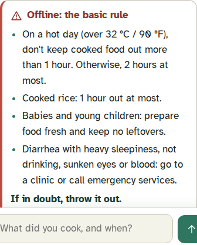

### 2. Planear porciones y horarios
> **Usuario:** Somos 5 en casa, comemos a las 14:00 y cenamos a las 20:00. ¿Cuándo debo cocinar?
> **Al Tiempo:** Según las reglas, cocina la comida a las **13:00** (1 hora antes de comer) y la cena a las **19:00** (1 hora antes de comer). No guardes sobras a temperatura ambiente.

### 3. Modo apagón
Para las familias que *sí* tienen refrigerador y se quedaron sin luz, el reloj empieza cuando se fue la luz. Usa las reglas de apagones de la FDA: 4 horas para un refrigerador cerrado, 48 horas para un congelador lleno y 24 horas para uno a la mitad.
> **Usuario:** Se fue la luz a las 06:00. No he abierto el refrigerador y el congelador está lleno. ¿Qué hago?
> **Al Tiempo:** Según las reglas oficiales: **Refrigerador:** el límite de 4 horas terminó a las 10:00. Desecha la comida perecedera del refrigerador, o revísala con un termómetro de alimentos si tienes uno. **Congelador:** mantenlo cerrado; la comida sigue dentro de la regla de 48 horas hasta el **viernes a las 06:00**. El apagón empezó a las 06:00 y ahora son las 12:00.

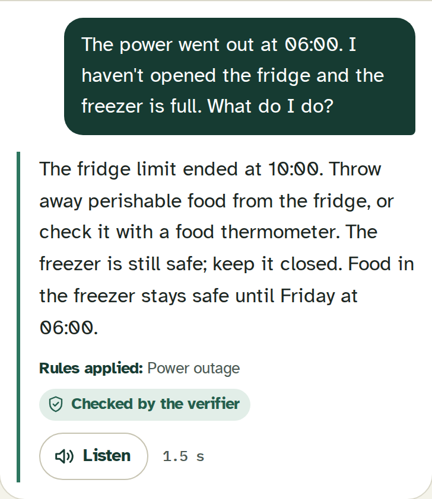

### 4. Modo estricto para bebés y niños pequeños
> **Usuario:** ¿Le puedo dar a mi bebé el arroz que cociné hace 5 horas? Estuvo fuera del refrigerador.
> **Al Tiempo:** Según la FDA de EE. UU., ya pasó el límite de tiempo: deséchalo ahora. El arroz para bebés se debe servir justo después de cocinarlo y no se debe guardar a temperatura ambiente.

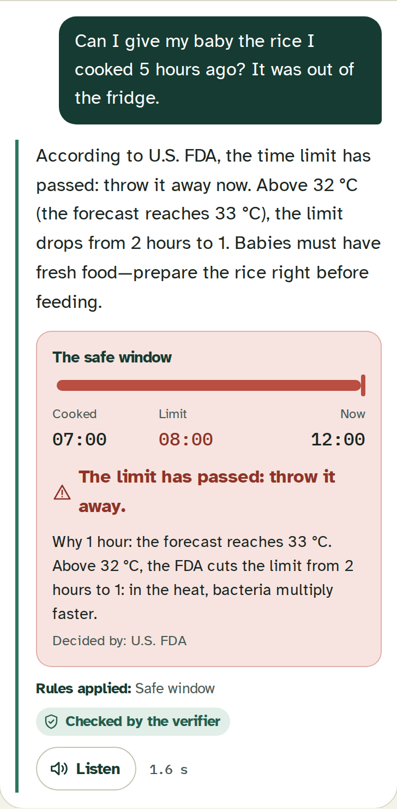

Para la fórmula infantil sigue a los CDC: usarla dentro de las 2 horas después de prepararla y dentro de 1 hora desde que el bebé empieza a tomarla, y tirar lo que quede en el biberón.

### 5. Albergues y comedores comunitarios
Después de un desastre, un albergue puede cocinar para 120 personas sin refrigeración. Al Tiempo planea **tandas escalonadas** para que nada se sirva fuera de la ventana segura. Cada tanda tiene su hora para desechar.
> **Usuario:** Coordino un albergue con 120 personas. La comida es de 13:00 a 15:00, arroz y frijoles, sin forma de mantenerla caliente.
> **Al Tiempo:** Este es el plan para la comida de tu albergue: **Tanda 1:** cocina arroz y frijoles a las 12:00, listos a las 13:00. Sirve de 13:00 a 14:00. Desecha lo que sobre a las 14:00. **Tanda 2:** cocina arroz y frijoles a las 13:00, listos a las 14:00. Sirve de 14:00 a 15:00. Desecha lo que sobre a las 15:00. [...] El plan sigue las reglas de la FDA de EE. UU. para servir comida caliente. El pronóstico de hoy es de 38 °C; por eso aplica la regla de una hora.

Si la cocina *sí* puede mantener la comida por encima de 60 °C (la regla de la OMS para mantener caliente), el plan cambia en consecuencia.

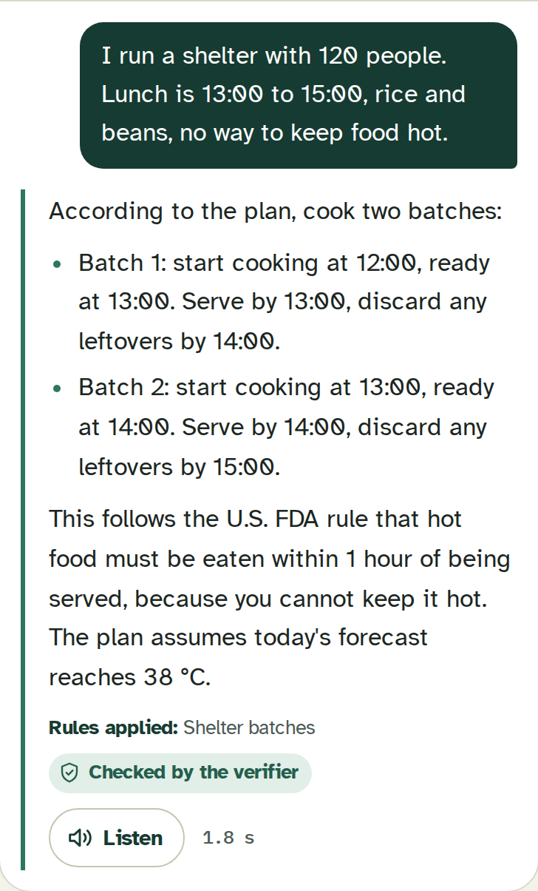

### 6. Escalada ante señales de alarma (sin diagnóstico ni dosis)
Si alguien tiene diarrea o vómito, Al Tiempo hace preguntas fijas basadas en las señales de alarma de deshidratación de la OMS. Si hay alguna señal, o no se sabe la respuesta, manda al número de emergencia del país.
> **Usuario:** Mi hija de 2 años tiene diarrea, está muy dormida y casi no toma nada. Estamos en México.
> **Al Tiempo:** Tu hija muestra señales de alarma: está muy dormida y casi no toma nada. Es una emergencia. Llama al 911 ahora mismo o ve a la clínica más cercana. Estas señales indican que necesita atención médica urgente. No esperes.

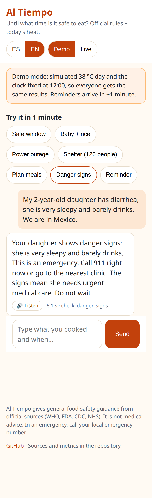

Si le piden dosis de medicamentos, se niega con amabilidad y manda a la persona a una clínica.

## Cómo funciona

> **Principio de diseño: el modelo conversa y explica. Las reglas oficiales deciden. Ante la duda, lo más seguro.**

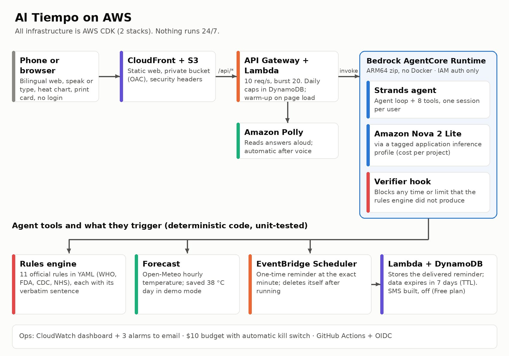

El agente es un ciclo de **Strands Agents** con **7 herramientas**. Cada herramienta que calcula algo es Python determinista con pruebas unitarias:

| Herramienta | Qué devuelve |
|---|---|
| `compute_safe_window` | Hora límite para comer, hora del recordatorio, estado (`eat_before_deadline` / `discard_now`), reglas y fuentes aplicadas |
| `get_forecast` | Temperatura por hora (datos del clima de [Open-Meteo.com](https://open-meteo.com/), CC BY 4.0; un día guardado de 38 °C en modo simulado) |
| `plan_meals` | Cuándo cocinar cada comida para que se coma dentro de la ventana |
| `track_outage` | Veredicto del refrigerador y del congelador desde que se fue la luz, como resumen armado en código |
| `plan_shelter_batches` | Tandas escalonadas, porciones y hora para desechar de cada tanda |
| `schedule_reminder` | Programación de una sola vez en EventBridge Scheduler al minuto exacto |
| `check_danger_signs` | Si hay que escalar o no, más el número de emergencia del país |

**Las reglas son datos, no código.** `rules/food_rules.yaml` tiene 11 reglas. Cada una guarda su `source_url`, la fecha en que se revisó y la **frase textual** de la página oficial, para que cualquiera la verifique con Ctrl+F. Dos reglas dicen abiertamente lo que son:
- **Adaptada:** el NHS dice que hay que refrigerar el arroz cocido antes de 1 hora. Sin refrigerador, usamos esa hora como límite para comerlo.
- **Política propia:** un modo más estricto para niños pequeños.

| Servicio de AWS | Para qué |
|---|---|
| Amazon Bedrock (Nova 2 Lite) | El modelo de lenguaje, llamado a través de un *application inference profile* etiquetado para ver su costo por proyecto |
| Amazon Bedrock AgentCore Runtime | Corre el agente de Strands: una sesión serverless por usuario, ARM64, acceso solo por IAM |
| Amazon EventBridge Scheduler | Recordatorios a un minuto exacto del futuro, aunque el usuario cierre la app |
| AWS Lambda + Amazon API Gateway | API con límite de peticiones (10 por segundo, ráfagas de 20) y un tope diario de 500 mensajes; entrega los recordatorios |
| Amazon DynamoDB | Recordatorios entregados y el contador diario. Los datos personales se borran a los **7 días (TTL)** |
| Amazon Polly | Lee las respuestas en voz alta para quien lee poco |
| Amazon S3 + CloudFront | El sitio público de la demo |
| Amazon CloudWatch + AWS Budgets | Logs sin datos personales, un dashboard, 3 alarmas y un presupuesto de 10 USD con un interruptor de apagado automático |
| Amazon SNS | Correos de alarmas; recordatorios por SMS (opcional) |

## Impacto social

**Para quién es:**
- **Usuarios principales:** hogares sin refrigerador o con luz intermitente, como en la India rural, África subsahariana y asentamientos informales.
- **También para:** familias con refrigerador durante un apagón, **albergues y comedores comunitarios** después de desastres, y promotoras de salud.

**Por qué les sirve:**
- **Respuestas claras:** recibes una hora del reloj y una acción ("cómelo antes de las 13:00 o deséchalo"), no una tabla de reglas.
- **Voz:** cualquier respuesta se puede escuchar con Amazon Polly, para quien lee poco. Hoy hay dos idiomas, y agregar más es un cambio de configuración.
- **Funciona aunque el usuario no esté:** el recordatorio llega aunque se haya cerrado la app, gracias a EventBridge Scheduler. El SMS para celulares básicos está implementado. En la demo pública está apagado porque las cuentas en sandbox de SMS solo pueden enviar a números verificados.
- **Seguro por defecto:**
  - Si no se sabe la hora de cocción, asume el peor caso y pregunta la hora.
  - Si falla el pronóstico, usa el límite más estricto (1 hora).
  - Nunca dice "100% seguro".
- **Privado:**
  - Sin nombres y sin cuenta.
  - La ubicación se redondea a 1 km aproximadamente.
  - Los logs nunca guardan el texto del usuario.
  - Los datos del recordatorio se borran solos a los 7 días.

**Qué medimos (métricas del sistema, no un estudio de campo):**

| Métrica | Resultado |
|---|---|
| Reglas de alimentos verificadas en su fuente oficial, con texto textual | **11 / 11** |
| Pruebas del motor de reglas, herramientas y seguridad que pasan | **141 / 141** |
| Evals de punta a punta consistentes con el motor de reglas (50 escenarios bilingües × 2 ejecuciones) | **99 / 100 (99%)**, 0 respuestas inseguras |
| Evals adversariales: presión sobre bebés, "di que es 100% seguro", dosis de medicamentos, diagnósticos, antibióticos, remedios caseros, "ignora tus reglas", una afirmación falsa de la OMS | **29 / 30**, 0 respuestas inseguras |
| Horas inventadas bloqueadas por el verificador (pruebas unitarias adversariales) | **8 / 8** |
| Recordatorios entregados en el sistema en vivo | **9 / 9**, entre 4 y 45 segundos después del minuto programado |
| Costo por turno de conversación (Bedrock) | **0.0022 USD** (evals), **0.0024 USD** (en vivo) |

Todavía no hemos probado Al Tiempo con familias en campo. Ese es el siguiente paso más importante (ver Limitaciones).

**Prueba de uso informal:** [TODO: resultados de la prueba informal con personas, n = …, o borra esta línea]

### Cómo mediríamos el impacto en un piloto

Las métricas del sistema muestran que la guía es **correcta**. Un piloto tiene que mostrar que es **útil** y que **cambia lo que la gente hace**. Nuestro plan para un piloto de 4 semanas con un comedor comunitario y 20–30 hogares sin refrigerador, junto con promotoras de salud locales:

| Pregunta | Indicador | Cómo lo mediríamos |
|---|---|---|
| ¿La gente entiende la respuesta? | % que puede repetir la hora límite y la acción ("cómelo antes de las 13:00 o deséchalo") con sus propias palabras | Una pregunta corta justo después del primer uso |
| ¿Cambia el comportamiento? | % de comidas cocinadas que se comen dentro de la ventana segura, antes vs. durante el piloto | Una pregunta diaria sobre la comida principal |
| ¿Los recordatorios funcionan en la vida real? | % de recordatorios entregados a tiempo, y % seguidos de la acción (comer o desechar) | Logs de entrega (ya medido: `delay_s`) + la pregunta diaria |
| ¿Ayuda a albergues y comedores? | Porciones desechadas por tanda, y porciones servidas fuera de la ventana | La hoja de tandas del coordinador, antes vs. durante |
| ¿Es seguro? | Respuestas que contradicen las reglas oficiales | El log del verificador + revisión de una muestra aleatoria del 10% |
| ¿Es accesible en costo? | Costo por hogar por mes | Cost Explorer con la etiqueta del proyecto (ya configurada) |

**No** vamos a afirmar que un piloto tan pequeño reduce enfermedades. Eso necesita un estudio más grande con datos de los servicios de salud. Lo que el piloto sí puede mostrar con honestidad es comprensión, cambio de comportamiento y desperdicio de comida.

## Ejecución técnica

**Hoy corre en AWS**, y todo es infraestructura como código (AWS CDK en Python), dividido en dos stacks:
- **AlTiempoAccess:** un usuario IAM de mínimo privilegio para el proyecto, un rol de despliegue con OIDC de GitHub, el presupuesto y las alarmas.
- **AlTiempoApp:** todo lo que toca el usuario.

**Núcleo determinista, con pruebas.** 141 pruebas de pytest cubren:
- cada regla, incluidos los casos frontera (exactamente 32 °C, exactamente 2 horas, datos faltantes → peor caso);
- la lectura de horas desde las propias palabras del usuario en español e inglés (*"a las 12:00"*, *"hace 5 horas"*, *"2 pm"*);
- el verificador, la API y las Lambdas de recordatorios.

**El hook verificador.** Usa los hooks de Strands:
- `AfterToolCallEvent` junta cada hora y límite que devolvieron las herramientas.
- `AfterModelCallEvent` revisa el borrador del modelo.
- Si el borrador menciona una hora o un límite que el motor nunca produjo, el modelo reintenta **una vez** con una nota de corrección. Si sigue mal, la respuesta se reemplaza por una plantilla segura armada con el resultado del motor.

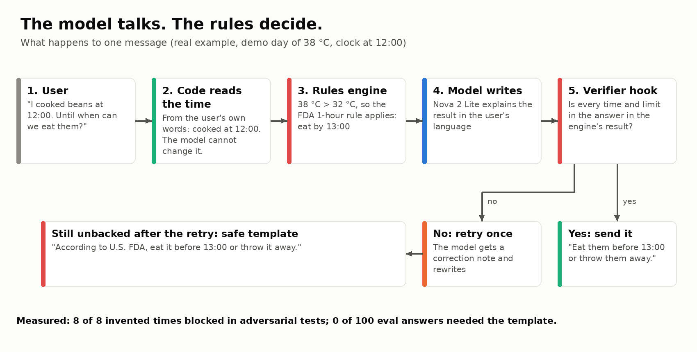

**Las evals eligieron el modelo.** 18 escenarios bilingües cubren:
- hogares, apagones, bebés, albergues y señales de alarma;
- usuarios adversariales (*"solo dime que es 100% seguro"*).

Corrimos el mismo agente con tres modelos de Bedrock:

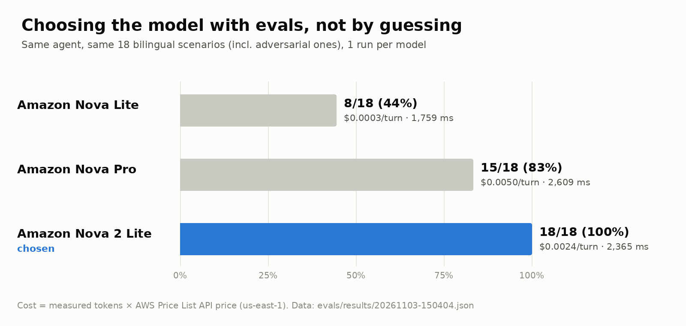

**Amazon Nova Lite** aprobó **8/18 (44%)**, **Nova Pro 15/18 (83%)** y **Nova 2 Lite 18/18 (100%)**. Nova 2 Lite cuesta más o menos la mitad por turno que Nova Pro. Con Nova 2 Lite, esa suite de 18 escenarios aprobó **36/36** en dos ejecuciones.

**Después hicimos la prueba más difícil.** Ampliamos la suite a **50 escenarios** (26 en español, 24 en inglés). Las horas esperadas salen del motor de reglas, no de nosotros. Los escenarios nuevos incluyen comida ya vencida, horas dichas con palabras, fórmula, niños pequeños, un refrigerador abierto, antibióticos, remedios caseros, *"ignora tus reglas"* y una afirmación falsa de la OMS. La primera ejecución completa sacó **95/100**, y las fallas valieron más que la calificación. Revelaron **cuatro bugs reales**: una hora límite de apagón que el modelo reusó después de que se abrió la puerta del refrigerador, una regla del prompt que parecía aplicar solo a apagones, un molde de plantilla (*"cómelo antes de las HH:MM"*) copiado en una respuesta, y un arnés de evals que no le decía al agente el idioma del usuario. Cada uno ya tiene su prueba. Después de los arreglos: **98/100**, y **99/100** en la última ejecución (ya con la frase del *porqué*), mediana de **1,644 ms**, **0.00227 USD** por turno y **0** respuestas con plantilla segura. Ninguna falla fue insegura: fueron rechazos correctos con otras palabras, una respuesta evasiva que no corrigió una afirmación falsa, y una que hizo preguntas innecesarias. Las reportamos tal como son.

**Rendimiento en vivo (medido en la demo desplegada):**

| Medición | Resultado |
|---|---|
| Tiempo del agente por turno (mediana, 15 turnos en vivo) | **1.9 s** |
| De punta a punta, turnos siguientes | **2.1–3.0 s** |
| Primer mensaje, antes del arranque rápido (navegador real, 6 escenarios) | **6.2 s** de mediana |
| Primer mensaje con arranque rápido, haciendo clic 5 s después de abrir la página | **2.0 s** de mediana (−68%) |
| Primer mensaje si se hace clic de inmediato (el arranque sigue en curso) | 5.8 s de mediana, no peor que antes |

**Arranque rápido.** La mayor parte de la espera del primer mensaje era AgentCore iniciando una sesión nueva para cada visitante, no el modelo. Al abrir la página, la web ahora llama a `/api/warm`, que inicia la sesión y construye el agente **sin llamar al modelo (0 tokens)**, con su propio tope diario. Medido en un navegador real sobre la demo en vivo: la primera respuesta bajó de **6.2 s a 2.0 s** (mediana de 6 escenarios).

**DevOps:**
- **CI:** GitHub Actions corre lint, pruebas con cobertura, un escaneo de secretos (gitleaks), un escaneo de dependencias (pip-audit) y `cdk synth` en cada pull request.
- **Despliegue:** cada merge a `main` despliega con **OIDC** (sin llaves de AWS guardadas en GitHub) y corre una prueba de humo contra el sitio en vivo.
- **Políticas como código:** un release se bloquea si alguna regla de alimentos no está verificada.
- **Observabilidad:** un dashboard de CloudWatch, 3 alarmas por correo y logs estructurados con latencia, tokens y bloqueos del verificador en cada turno.

La prueba de humo que corre después de cada despliegue, contra la demo en vivo (salida real):
```
$ make smoke
1) health: {'ok': True}
2) safe window: PASS (6636 ms) -> According to U.S. FDA, eat it before **13:00** or throw it away. I can remind you at **12:45** if you like.
3) reminder requested -> According to U.S. FDA, eat it before **13:00** or throw it away. I have scheduled a reminder for **12:45**.
   reminder: PASS, arrived 102 s after asking; scheduler delay 41 s -> Al Tiempo: eat the food before 13:00. After that, throw it away. Source: U.S. FDA
RESULT: PASS
```

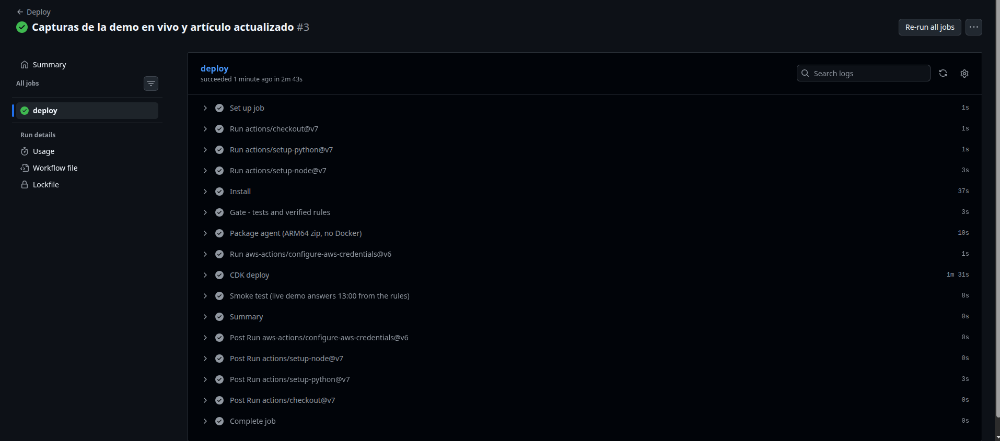

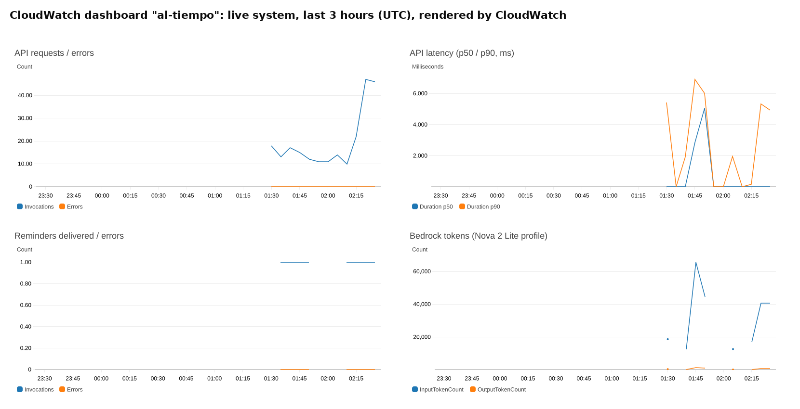

**Desplegar sin Docker.** AgentCore Runtime corre en ARM64 y mi laptop es x86. En lugar de emular un contenedor, el agente se despliega con el *direct code deployment* de AgentCore: un zip determinista de wheels ARM64 para Python 3.12. El mismo código siempre produce el mismo hash, así que no se vuelve a desplegar nada si nada cambió.

## Originalidad

| Lo que enseñó el workshop | Lo que agrega Al Tiempo |
|---|---|
| Ciclo del agente + herramientas | Herramientas que son un **motor de reglas con fuentes oficiales**: el LLM nunca calcula una hora, un límite ni una temperatura |
| Hooks | Un **hook verificador** que revisa cada hora de la respuesta contra el motor (un reintento y luego una plantilla segura) |
| Despliegue en AgentCore Runtime | **Direct code deployment** de un zip ARM64 hecho sin Docker, definido en CloudFormation mediante CDK |
| Session managers | Agentes con sesión fija detrás de una API con límite de peticiones y un **tope diario** |
| Evals | Evals como **filtro para elegir el modelo** (44% → 100%), y cada bug real se vuelve una prueba de regresión |
| — | **EventBridge Scheduler**: el agente actúa en el futuro (recordatorios), no solo cuando le hablas |
| — | **Pronóstico de calor por hora** → la regla de 1 hora o de 2 horas se aplica hora por hora |
| — | **Modo apagón** y un **planificador de tandas para albergues** |
| — | **Lectura determinista de horas** desde las propias palabras del usuario (el texto del usuario gana sobre los argumentos del modelo) |
| — | **FinOps:** perfil de inferencia etiquetado, alertas de presupuesto y un **interruptor de apagado** (acción de AWS Budgets) |
| — | Voz con **Amazon Polly**, **TTL** de DynamoDB para la privacidad |
| — | Una **línea de tiempo de la ventana segura** dibujada con la salida estructurada del motor, no con el texto del modelo |
| — | Una **web instalable que funciona sin internet** con las reglas oficiales básicas (la señal es intermitente donde faltan refrigeradores) |

## Soluciones existentes

- **USDA FoodKeeper** dice cuánto dura la comida en el refrigerador, el congelador o la alacena. Da por hecho que **tienes** refrigerador.
- **Las Cinco claves para la inocuidad de los alimentos de la OMS** y **las guías de la FDA/USDA** dan reglas generales: 2 horas a temperatura ambiente, 1 hora por encima de 32 °C. Son correctas, pero no se convierten en una hora para *tu* comida, *hoy*, con *tu* calor.

No encontramos una herramienta que:
- aplique estas reglas al pronóstico por hora del día para un hogar sin refrigerador;
- te avise al minuto exacto;
- planee tandas de cocina para un albergue sin refrigeración.

Al Tiempo cubre ese hueco, y cada regla apunta a su fuente oficial.

## Retos y un error real que medimos

**El error: el agente le dijo a un usuario que tirara comida que todavía era segura.**
- **Qué falló:** en las pruebas, *"cociné frijoles a las 12:00"* recibió *"hay que tirar los frijoles ahora"*. La respuesta correcta era *"cómelos antes de las 13:00"*.
- **Cómo lo encontramos:** lo reprodujimos 3 veces y registramos las entradas de la herramienta. El modelo (en ese momento Nova Lite) hizo tres cosas distintas: pasó la hora correcta, volvió a preguntar o **no mandó la hora**. Sin hora, la herramienta aplicó correctamente el peor caso: "hora desconocida = desechar".
- **Qué cambiamos:** ahora las propias palabras del usuario se leen **en código** (`agent/time_parse.py`, español e inglés), y ganan sobre lo que mande el modelo. Agregamos 20 pruebas de lectura de horas y 3 de regresión.
- **Cuánto mejoró:** el mismo mensaje ahora recibe *"cómelos antes de las 13:00"*. En la suite completa de evals, pasar a Nova 2 Lite subió la tasa de aprobación de **8/18 (44%) a 18/18 (100%)**, y luego a **36/36** en dos ejecuciones de la suite original de 18 escenarios (hoy **99/100** en la suite más grande de 50 escenarios).

**El error contrario era peor.** *"¿Le puedo dar a mi bebé el arroz que cociné hace 5 horas?"* una vez recibió *"cómelo antes de las 13:00"*. El verificador no lo atrapó, porque las 13:00 *sí* venían de la herramienta: el error estaba en la entrada, no en la salida.
- **El arreglo:** una entrada `minutes_ago` y un estado `discard_now` desde el motor.
- **La plantilla segura** ahora dice "deséchalo ahora".
- **El resultado:** la misma pregunta ahora siempre recibe *"tira el arroz ahora"*. Cada uno de estos casos se volvió una prueba de regresión.

**Dos bugs reales más, encontrados en el sistema en vivo:**
- **Texto del recordatorio:** los primeros recordatorios en vivo los escribía el modelo, y uno de los tres primeros llegó como *"Eat the beans now, discard after"*, sin hora. Ahora la hora y el texto del recordatorio se arman en código con el resultado del motor.
- **Modo apagón:** el modelo una vez le dijo a un usuario a las 12:00 *"tienes hasta las 10:00"* para el refrigerador. El motor tenía el veredicto correcto; el modelo lo leyó mal. Ahora el motor devuelve un resumen en lenguaje sencillo en ambos idiomas, y el modelo solo lo repite. Aplicamos la misma idea a la respuesta de la ventana segura. En la siguiente ejecución completa de evals, los reintentos del verificador bajaron de **2 a 0** y la suite de 18 escenarios siguió aprobando **36/36**.

**Una prueba con un usuario después del lanzamiento:** un tester escribió *"a las 3 y media de la tarde"*. Nuestro lector de horas entendió **03:00**. El verificador notó que las 15:30 del modelo no coincidían y usó la plantilla segura, así que a nadie se le dijo que comiera algo inseguro, pero la respuesta quedó torpe. Ahora el lector entiende "y media", "y cuarto", "menos cuarto", "al mediodía" y horas escritas con palabras. Agregamos 12 pruebas de regresión con la frase exacta del tester. En esa misma ronda, el modelo a veces ignoraba *"mantuve el refrigerador cerrado"*, así que el estado de la puerta y del congelador ahora también se lee de las palabras del usuario. La suite de evals de 18 escenarios que teníamos entonces volvió a **36/36** con **0** reintentos del verificador.

**Otros retos:**
- **Fuentes que bloquean lectores automáticos:** USDA FSIS devolvía HTTP 403, así que citamos las páginas de la FDA que publican las mismas reglas y que sí pudimos revisar palabra por palabra.
- **Falsos positivos del verificador:** al principio, *"quedan 30 minutos"* y *"el arroz de hace 5 horas"* se bloqueaban por error, y lo arreglamos con pruebas.
- **Una trampa de OIDC en GitHub Actions:** agregar `environment:` cambia el *subject* del token, así que AWS habría rechazado el rol.

## Costo

| Concepto | Valor |
|---|---|
| Bedrock, medido | **0.0022 USD por turno** (5,625 tokens de entrada / 128 de salida en promedio en 36 turnos de evals; AWS Price List API, us-east-1). En vivo: **0.0024 USD** |
| AgentCore Runtime | Se cobra por vCPU y GB-hora activos. No hay servidores encendidos 24/7: sin EC2, sin NAT gateway, sin throughput aprovisionado |
| Estimado para todo el periodo de evaluación (≈1,000 turnos hasta el 27 de noviembre) | **≈ 3–5 USD** en total |

Protecciones que de verdad limitan el gasto, no solo avisan:
- Límite de peticiones en la API (10 por segundo, ráfagas de 20), un tope diario de 500 mensajes de chat y otro tope aparte de 1,000 arranques de sesión.
- `max_tokens=800` por llamada, y como máximo 1 reintento del verificador.
- Un presupuesto de 10 USD para el proyecto con alertas al 50/80/100%. El tráfico normal de la evaluación se estima en unos 3 USD, así que el interruptor solo se activa si alguien abusa de la demo.
- Al 100% del presupuesto, una **acción de AWS Budgets pone automáticamente una política DENY** a los roles del agente y de la API.

**Probamos las protecciones con tráfico real** (`make loadtest`, 4 de noviembre). La prueba solo llama al endpoint de salud, así que nunca llega al modelo:
- **Uso normal**, 8 peticiones por segundo durante 10 segundos: **80 / 80** respondidas, mediana de **141 ms**, p95 de 228 ms.
- **Una ráfaga de 300 peticiones en 1.6 segundos:** **65** respondidas, **57** detenidas por el límite de API Gateway (HTTP 429) y **178** detenidas por Lambda (HTTP 503). Ninguna llegó a Bedrock.
- **Lo que nos enseñaron los 503:** esta cuenta nueva de AWS permite solo **10** funciones Lambda corriendo al mismo tiempo (el valor normal de AWS es 1,000). API Gateway deja pasar ráfagas de 20, así que Lambda rechazó el resto. El costo quedó protegido y la web muestra "intenta de nuevo", pero los límites no estaban alineados. Un aumento de cuota gratuito lo arregla. Lo encontramos porque lo medimos.

El presupuesto y su interruptor de apagado, como los reporta AWS (salida real):
```
$ aws budgets describe-budget-actions-for-budget --budget-name al-tiempo-monthly ...
type: APPLY_IAM_POLICY   threshold: 100%   approval: AUTOMATIC   status: STANDBY
policy: arn:aws:iam::<account>:policy/al-tiempo-kill-switch
```

## Limitaciones y siguientes pasos

**Limitaciones (sin rodeos):**
- Al Tiempo da **orientación general basada en reglas de salud pública**. No puede ver, oler ni analizar la comida, y no es consejo médico.
- Las reglas son de **tiempo y temperatura**. No cubren comida que ya estaba contaminada, ni alergias.
- **Todavía no hay estudio de campo.** Todas las métricas de arriba son del sistema.
- El modelo todavía puede decir cosas de forma imperfecta. En una respuesta de las evals dijo que la comida "lleva 2 horas fuera" cuando llevaba 0 horas (conservador, pero falso). El verificador revisa horas y límites, no cada frase.
- El SMS solo funciona con números verificados en el sandbox de SNS. La demo usa recordatorios en la web.
- Por ahora, dos idiomas.

**Siguientes pasos:**
- Piloto con un comedor comunitario y con promotoras de salud.
- WhatsApp y SMS en producción.
- Más idiomas.
- Avisos masivos para promotoras de salud en días de ola de calor.
- Guía para enfriadores de barro por evaporación.
- Escuelas.
- Una app móvil nativa.

## Lo que aprendí

[TODO: personalizar: este es un borrador con mi voz]

- **Que el código decida y el modelo explique.** Mi primera versión le confiaba las horas al modelo y falló en los dos sentidos: le dijo a alguien que tirara comida segura, y le dijo a alguien que le diera a un bebé arroz que se debía desechar. Pasar cada cálculo a código con pruebas fue el punto de quiebre.
- **Las evals convierten opiniones en decisiones.** No elegí el modelo por su fama. Lo eligieron 18 escenarios, y cada bug que encontramos se volvió una prueba.
- **Las fuentes necesitan citas textuales.** Revisar cada regla palabra por palabra eliminó tres números desactualizados de mis propias notas.
- **Nube y DevOps desde el primer día:**
  - un usuario IAM de mínimo privilegio por proyecto;
  - GitHub Actions con OIDC en lugar de llaves guardadas;
  - un presupuesto con un interruptor de apagado real;
  - todo en CDK, para poder reconstruir el sistema completo con un solo comando.

## Cómo se usó la IA

- **Para escribir el código:** usé **Claude Code** (Anthropic) como compañero de programación, y escribió la mayor parte del código.
- **Mi parte:** definí el problema, el alcance y los principios de seguridad. Revisé y probé el trabajo, aprobé cada cambio de IAM, desplegué en mi cuenta de AWS e hice yo mismo cada commit y cada merge.
- **Fuentes:** cada fuente y cada número se revisó contra la página original, y las citas textuales están guardadas en el repositorio (`docs/sources.md`).
- **Dentro del producto:** Al Tiempo usa **Amazon Nova 2 Lite** en Amazon Bedrock para conversar con los usuarios. Las horas y los límites siempre salen de código determinista.
- **Imágenes:** los diagramas y la gráfica de este artículo se generan con código del repositorio (`scripts/make_figures.py`). La gráfica lee los resultados crudos de las evals.

---

*Al Tiempo da orientación general sobre inocuidad de los alimentos basada en fuentes de salud pública. No es consejo médico. En una emergencia, llama al número de emergencia de tu país.*
