# Al Tiempo: an AI agent that tells families and shelters without refrigeration until what time cooked food is safe to eat

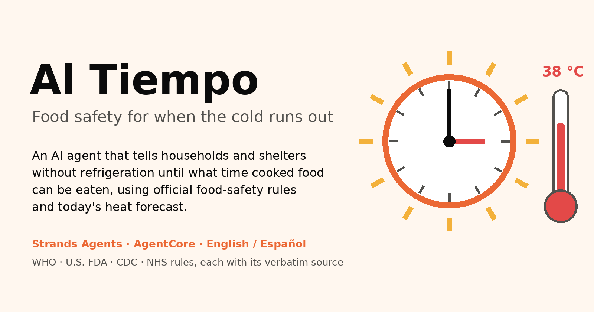

**In one minute:** Al Tiempo ("at room temperature" in Mexican Spanish) is a bilingual (English/Spanish) agent built with the **Strands Agents SDK** and running on **Amazon Bedrock AgentCore Runtime**. You tell it, typing or out loud, what you cooked or are about to cook and when. It answers with a clock time, for example *"eat the beans before 13:00 or throw them away"*, based on official food-safety rules (WHO, U.S. FDA, CDC, NHS) and today's hourly heat forecast. It can also schedule a reminder for that exact minute. The language model never calculates a time: a tested rules engine does, and a verifier hook blocks any answer whose times don't match it.

**Focus area: Health** (preventing foodborne illness). Heat, power outages and disasters are the risk factors and the context of use, not a second focus area.

| Judging criterion | Evidence in numbers |
|---|---|
| **Social Impact** | Built for the **339 million rural poor and 746 million urban poor** at high risk from lack of cooling, and the **655 million** people without electricity. **11 of 11** rules verified word by word on official sources. |
| **Technical Execution** | Live on AWS. **244** automated tests. **50 of 50** bilingual end-to-end scenarios in the final run, **18 of 18** held-out scenarios written after tuning, **11 of 11** multi-turn follow-ups. **26 questions real people asked**, read by hand: **24 right, 2 doubtful, 0 wrong, 0 unsafe** (first run: 15 / 4 / 7, 2 unsafe). **8 of 8** invented times blocked by the verifier. **9 of 9** live reminders delivered within a minute. |
| **Communication** | Demo with no login, buttons for 8 ready-made scenarios, a **traffic light** with the time in large type, **speak or type** with the answer read aloud, today's **heat curve**, a **printable kitchen card**, and a mobile-first layout. Every number in this article has a public source link. |
| **Originality** | Applies official rules to the **hourly forecast**; future reminders through **EventBridge Scheduler**; a **shelter batch planner**; **power-outage mode**; a **verifier hook** that fact-checks the model against deterministic code. |

---

## The problem

*Imagine a mother in a home without a refrigerator on a 38 °C afternoon. At 9:00 she cooked rice and beans for the whole day. At 14:00 her two-year-old is hungry. Is the rice still OK?*

She has no fridge, no thermometer, and no time to look up guidelines. If she guesses wrong, her child pays for it. Heat makes it worse.

- **866 million people fall ill and 1.52 million die every year** after eating contaminated food. Children under 5 carry **29%** of that burden, with **143,000 deaths in 2021** ([WHO food safety fact sheet, 4 June 2026](https://www.who.int/news-room/fact-sheets/detail/food-safety)).
- Heat matters. In 10 European populations, reported salmonellosis cases rose **linearly with temperature above 6 °C** ([Kovats et al., 2004](https://pmc.ncbi.nlm.nih.gov/articles/PMC2870124)).
- Refrigeration is not universal:
  - **655 million** people had no electricity in 2024, and **88.8%** of them live in Africa ([Tracking SDG7 2026, SEforALL](https://www.seforall.org/system/files/2026-07/SEforALL%20Tracking%20SDG7%20-%20The%20Energy%20Progress%20Report%202026_Executive%20Version_22Jul2026-2.pdf)).
  - In 77 heat-exposed countries, **339 million rural poor and 746 million urban poor** are at high risk of lacking adequate cooling ([Chilling Prospects 2026, via UNEP Cool Coalition](https://coolcoalition.org/news/chilling-prospects-2026-links-rising-heat-mortality-persistent-cooling-access-gaps)).
- In rural India, as reported by The Tribune from the NFHS-5 survey, **25.2%** of households have a refrigerator but **91.5%** have a mobile phone ([The Tribune, May 2022](https://www.tribuneindia.com/news/mobile-most-owned-item-survey-393691)). The phone is the cold chain's missing link.

The rules exist. The WHO says not to leave cooked food at room temperature for more than 2 hours, and the FDA cuts that to 1 hour above 90 °F (32 °C). But nobody turns them into *"eat it before 13:00 today"* for a family without a fridge.

## Try it in 1 minute

- **Live demo (no login):** https://d2mnz1h4b0sg0y.cloudfront.net
- **Code (MIT license):** https://github.com/Josegas/Al-Tiempo-Food-safety-for-when-the-cold-runs-out
- **Video (< 3 min):** [TODO: YouTube link]

1. Open the demo on your phone and choose **English** or **Español**.
2. Tap **I'm about to cook**. The page starts in **Simulated** mode: a saved 38 °C day and a clock fixed at 12:00, so everyone sees the same result. A green light shows **15:00** in large type, and the answer is *"If you cook it at 14:00, according to U.S. FDA, eat it before 15:00. In this heat (over 32 °C) bacteria grow faster: it lasts 1 hour, not 2. Cook only what will be eaten. Shall I remind you at 14:45?"* Say *"yes, remind me"*.
3. Tap **Already cooked** to see the same rule after cooking (green, with a live countdown), or ask about rice from 5 hours ago to see the red **Throw it away**. In Simulated mode the clock is accelerated, so a reminder arrives in about **1 minute**.
4. Try **Shelter (120 people)**, **Power outage** and **Danger signs**. Tap **🔊 Listen** to hear any answer, or **🎤 Speak** to ask out loud (in Chrome).
5. Switch to **Live** mode to use your real location (rounded to about 1 km) and the real hourly forecast.

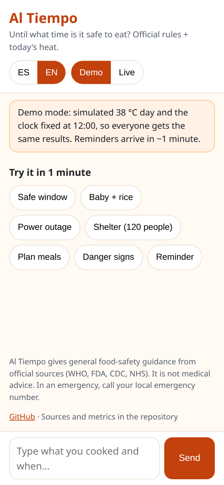

## What it does

Every answer below is a **real answer from the live demo** in simulated mode (38 °C day, clock at 12:00), copied as it came on 4 November; the screenshots are the same conversations on a phone. `[...]` marks where we shortened it.

### 1. Safe window + reminders (the core)
> **User:** I cooked beans at 12:00 and I have no fridge. Until what time can we eat them?
> **Al Tiempo:** According to U.S. FDA, eat it before **13:00** or throw it away. In this heat (over 32 °C) bacteria grow faster: it lasts 1 hour, not 2. Shall I remind you at **12:45**?
> **User:** Yes, please remind me.
> **Al Tiempo:** Reminder set for **12:45**: "Al Tiempo: eat the food before 13:00. After that, throw it away. Source: U.S. FDA".
> ⏰ **Reminder (12:45):** Al Tiempo: eat the food before 13:00. After that, throw it away. Source: U.S. FDA

If the user accepts, **Amazon EventBridge Scheduler** creates a one-time schedule for that exact minute, which deletes itself after running. The reminder reaches the web app (SMS is built but off in the demo; see Limitations). The reminder's time and text are built in code from the rules engine result: *"Al Tiempo: eat the food before 13:00. After that, throw it away. Source: U.S. FDA"*.

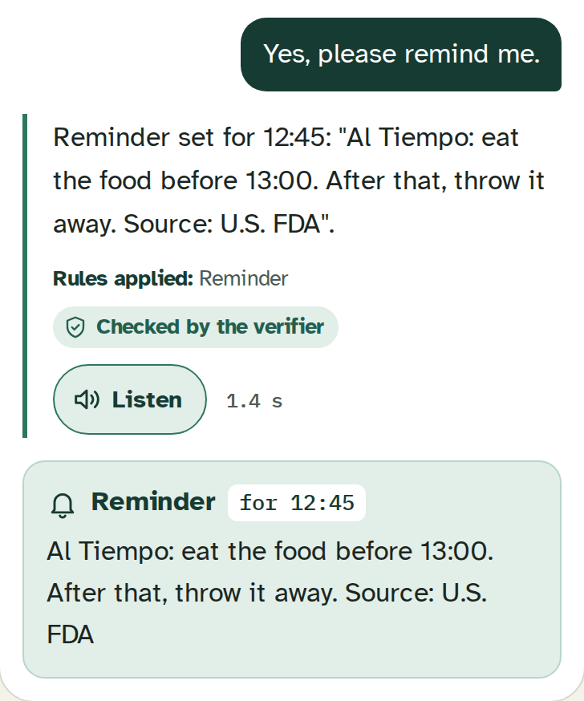

**Before cooking, not only after.** The most useful moment is before the food sits out, so the first button is the plan:
> **User:** I'm going to cook beans at 14:00 and I have no fridge. Until what time can we eat them?
> **Al Tiempo:** If you cook it at 14:00, according to U.S. FDA, eat it before **15:00**. In this heat (over 32 °C) bacteria grow faster: it lasts 1 hour, not 2. Cook only what will be eaten. Shall I remind you at **14:45**?

**A traffic light first.** Each answer with a decision starts with one colour and one big time, copied from the rules engine's output: **green** "eat it before 15:00" with a live countdown, **amber** when little time is left or the food won't last until mealtime, **red** "throw it away", and **grey** when a detail is missing ("when did you cook it?"). Someone who reads little gets the decision from the colour and the number. The **🔊 Listen** button reads the answer aloud (Amazon Polly).

| Green: before cooking | Red: rice from 5 hours ago, for a baby |
|---|---|
| 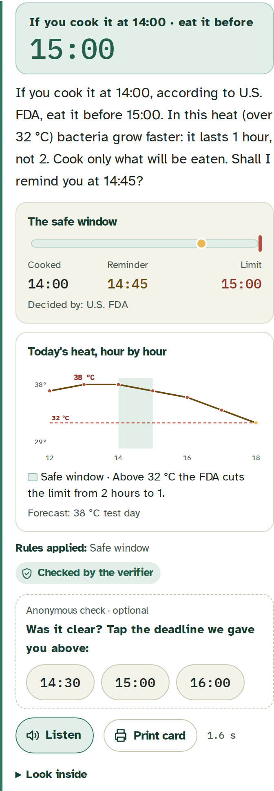 | 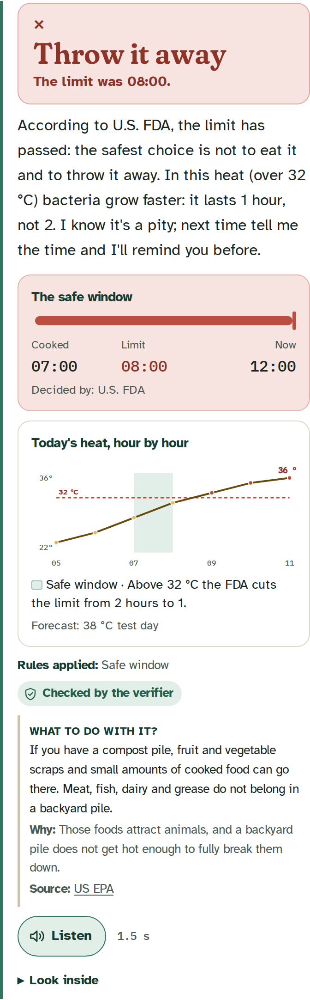 |

**It listens to the details people actually give.** We adapted 26 questions that real people asked in public forums (see *Challenges*). They don't say "I cooked at 12:00 and have no fridge". They say things like these, and all of them are read **in code** from the user's words:
- *"He eats at 3 on the building site"* → that is when it will be eaten, not when it was cooked. Live answer: **"It won't last until 15:00: according to U.S. FDA, eat it before 13:00 or throw it away. In this heat (over 32 °C) bacteria grow faster: it lasts 1 hour, not 2. Better to make it closer to mealtime."**
- *"The tamales are still in the steamer, steaming"* → WHO: food kept piping hot (above 60 °C) is not on the room-temperature clock; the clock starts when the heat goes off.
- *"It's in a room with air conditioning at 22 degrees"* → the user's room temperature replaces the outdoor forecast. Live answer: **"According to WHO, eat it before 13:00 or throw it away. At the 22 °C you told me, it lasts 2 hours, never more: out of the fridge bacteria multiply."**
- *"What do I do with the stew?"* (no time) → it asks when it was cooked, and says the rule meanwhile. The model is not allowed to invent a cooking time.
- *"Since last night"*, *"since 7am"*, *"an hour and a half ago"* → read correctly. (Before this round, "an hour and a half" was read as one hour: an error toward the unsafe side, now covered by a test.)
- *"Sorry, I didn't understand"* → the same engine result in one simpler sentence.

Every safe-window answer also says **why**, in a few words built in code: *"In this heat (over 32 °C) bacteria grow faster: it lasts 1 hour, not 2."* The longer reason, with the forecast numbers, is one tap away in "Look inside". Under the answer, the web draws a **timeline**: cooked → now → reminder → limit, with the minutes left, the reason and the rule that decided it. It is drawn only from the rules engine's numbers, which the API returns next to the text. It never reads times from the model's words.

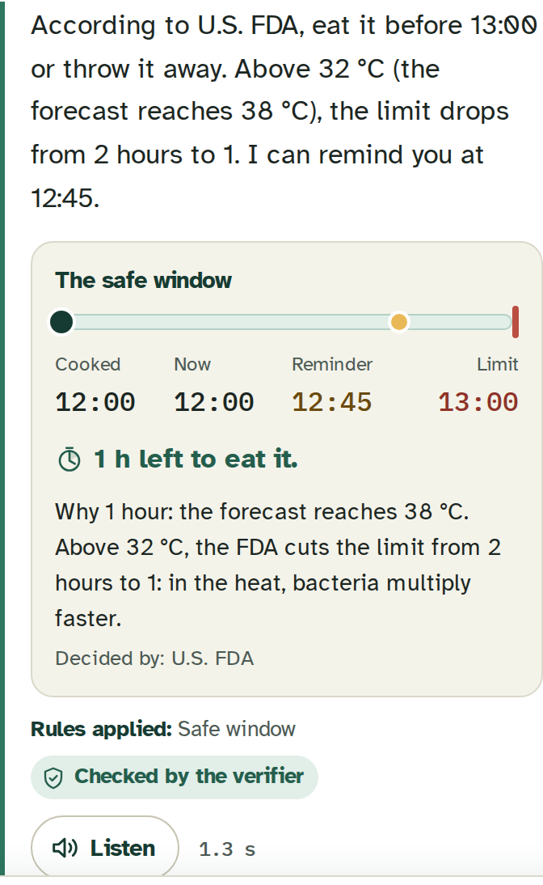

**No signal? It still helps.** The web app can be installed on a phone and opens without internet. The agent needs a connection, so offline it doesn't pretend to answer: it shows the basic official rules (1 hour on a hot day, 2 hours otherwise; rice 1 hour; no leftovers for babies; danger signs → clinic) with their sources.

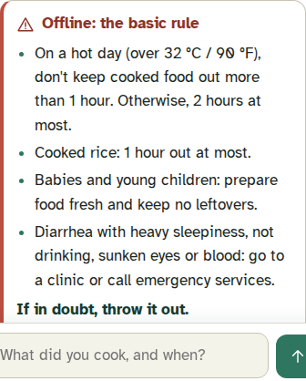

### 2. Plan portions and cooking times
> **User:** We are 5 at home, lunch at 14:00 and dinner at 20:00. When should I cook?
> **Al Tiempo:** According to the rules, cook lunch at **13:00** (1 hour before eating) and dinner at **19:00** (1 hour before eating). Do not keep leftovers at room temperature.

### 3. Power-outage mode
For families who *do* have a fridge and lost power, the clock starts when the power went out. It uses the FDA's outage rules: 4 hours for a closed fridge, 48 hours for a full freezer, 24 hours for a half-full one.
> **User:** The power went out at 06:00. I haven't opened the fridge and the freezer is full. What do I do?
> **Al Tiempo:** According to the U.S. FDA, fridge food is no longer safe after 4 hours (ended at **10:00**). Throw away perishable fridge food, or check it with a food thermometer. The freezer is still safe until **Friday 06:00** because it's full and closed. Keep it closed.

If the user says the ice in the freezer melted and froze again, the freezer's 24/48-hour rule no longer applies and the answer is to throw away the perishable food (a conservative project policy). If the user never mentioned a freezer, the answer doesn't talk about one, so the model can't "move" their raw chicken into it (a real eval failure, now a test).

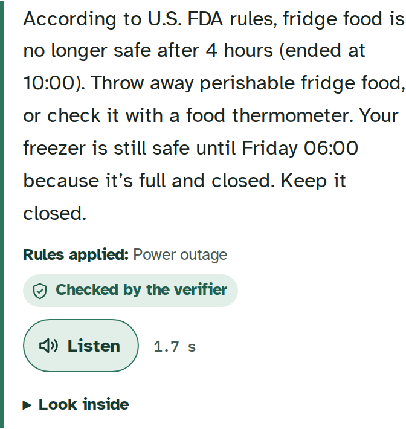

### 4. Strict mode for babies and young children
> **User:** Can I give my baby the rice I cooked 5 hours ago? It was out of the fridge.
> **Al Tiempo:** According to U.S. FDA, the limit has passed: the safest choice is not to eat it and to throw it away. In this heat (over 32 °C) bacteria grow faster: it lasts 1 hour, not 2. I know it's a pity; next time tell me the time and I'll remind you before.

For babies and young children the engine adds a stricter project rule (1 hour, serve right away, no leftovers); here the FDA heat rule already gave the same limit.

For infant formula, it follows the CDC: use it within 2 hours of preparation and within 1 hour from when feeding begins, and throw away what's left in the bottle.

### 5. Shelters and community kitchens
After a disaster, a shelter may cook for 120 people with no refrigeration. Al Tiempo plans **staggered batches** so nothing is served outside the safe window. Each batch gets a discard time.
> **User:** I run a shelter with 120 people. Lunch is 13:00 to 15:00, rice and beans, no way to keep food hot.
> **Al Tiempo:** [...] We scheduled two batches: first batch ready at **13:00**, discard at **14:00**; second batch ready at **14:00**, discard at **15:00**. No food should sit out past its discard time.

If the kitchen *can* keep food above 60 °C (the WHO hot-holding rule), the plan changes accordingly.

| On screen | Printed for the kitchen wall |
|---|---|
| 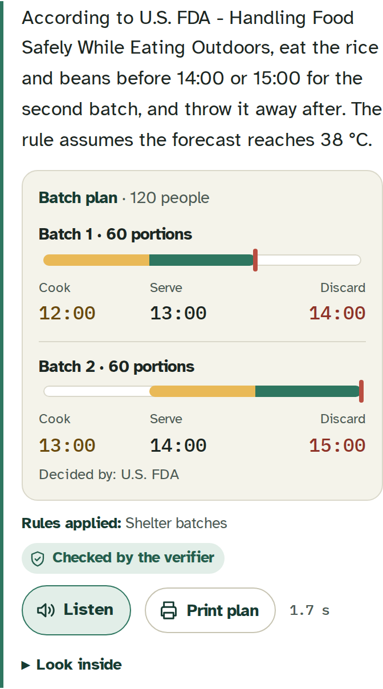 | 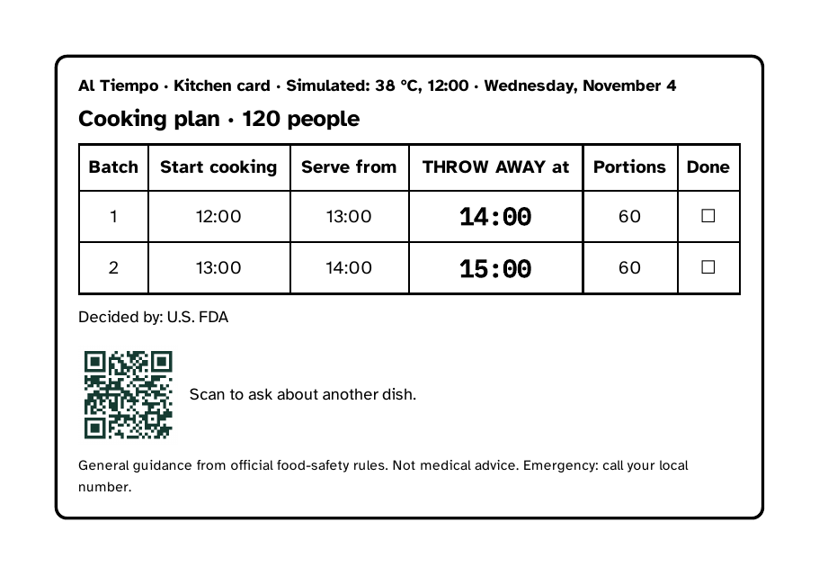 |

### 6. Danger-sign escalation (no diagnosis, no doses)
If someone has diarrhea or vomiting, Al Tiempo asks fixed questions based on the WHO's danger signs of dehydration. If any sign is present, or the answer is unknown, it escalates to the country's emergency number.
> **User:** My 2-year-old daughter has diarrhea, she is very sleepy and barely drinks. We are in Mexico.
> **Al Tiempo:** According to WHO, your daughter shows danger signs: very sleepy and barely drinks. This is an emergency. Call 911 or go to the nearest clinic right now. Do not wait.

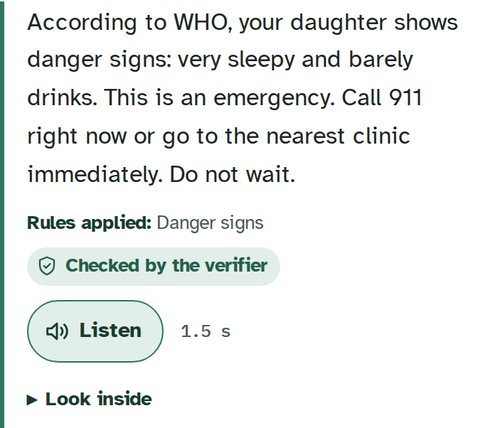

When asked for medicine doses, it declines kindly and sends the person to a clinic.

### Talk to it, see the heat, print it
- **Speak instead of typing.** A microphone button uses the browser's speech recognition (Chrome, Edge, Android). When the question was spoken, the answer is **read aloud automatically with Amazon Polly**: a full spoken conversation for people who read or type little. In Chrome the audio is processed by Google, and the button says so. We wanted Amazon Transcribe so the audio stays in AWS, but it is not available on this account's Free plan (same reason as SMS); it is the first next step.
- **Today's heat, hour by hour.** Under the safe window, a small chart draws the same hourly forecast the engine used, the 32 °C line, and the safe window shaded on top. You can *see* why today it's 1 hour and not 2. The forecast hours are kept out of the model's context, so they never become "allowed" times for the verifier.
- **A card for the kitchen wall.** "Print card" turns a safe window or a shelter plan into a big, plain page: the eat-by time in huge type (or a batch table with **THROW AWAY at** times and a "done" box), the deciding source, the mode (simulated or real) and the date, and a QR code back to the app. For a community kitchen without smartphones on every table, the plan lives on the wall.

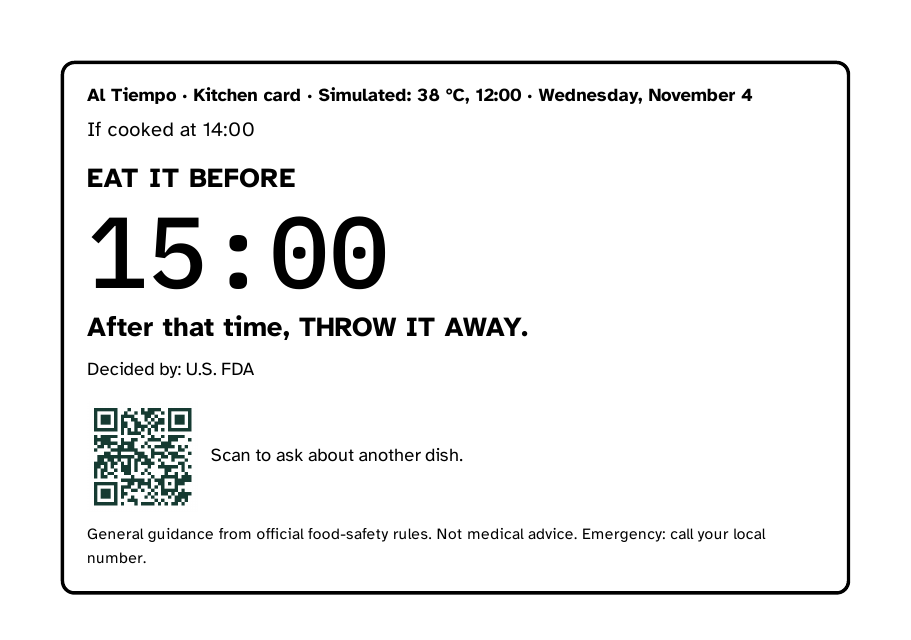

### Small notes after the decision (chosen in code, never changing it)
- **"What to do with it?"** When the answer is "throw it away", a small note says what can go in a home compost pile: fruit and vegetable scraps and small amounts of cooked food, but not meat, fish, dairy or grease, which attract animals ([US EPA, Composting At Home](https://www.epa.gov/recycle/composting-home)). It never suggests feeding spoiled food to animals.
- **Hygiene tip.** If the message is about raw salad, a cutting board used for raw chicken, or handwashing, one short tip from the [WHO Five Keys to Safer Food](https://www.who.int/docs/librariesprovider2/default-document-library/5keys_en.pdf) appears, with its reason. At most one per answer, and no chemical amounts ("if you use a disinfectant, follow its label").

## How it works

> **Design principle: the model talks and explains. Official rules decide. When in doubt, the safest option.**

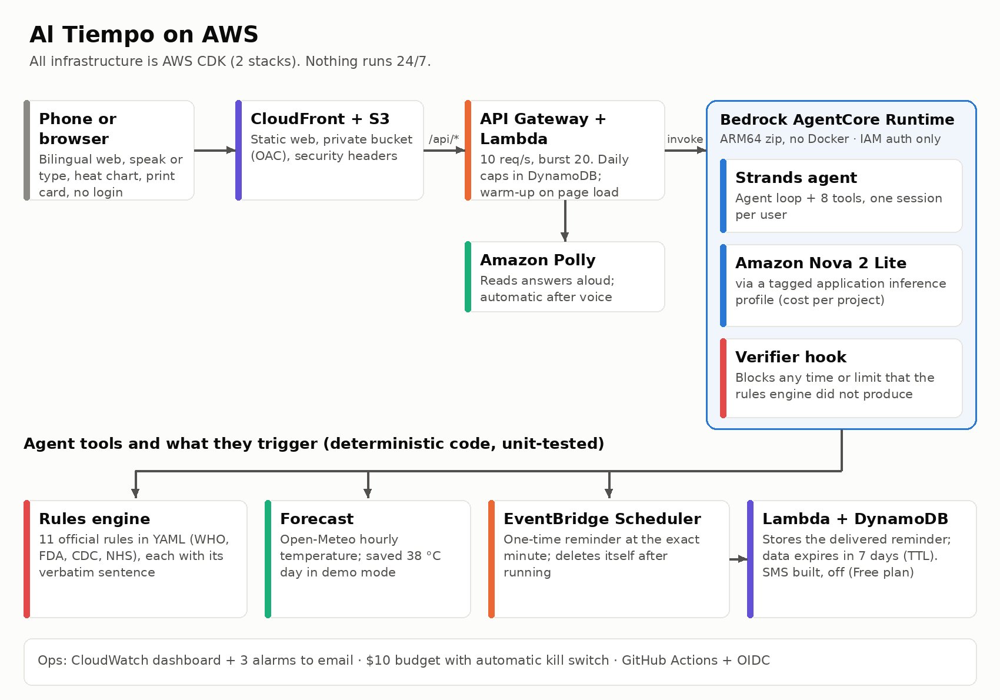

The agent is a **Strands Agents** loop with **8 tools**. Every tool that calculates something is deterministic Python with unit tests:

| Tool | What it returns |
|---|---|
| `compute_safe_window` | Eat-by time, reminder time, status (`eat_before_deadline` / `discard_now`), rules and sources applied |
| `get_forecast` | Hourly temperature (weather data by [Open-Meteo.com](https://open-meteo.com/), CC BY 4.0; a saved 38 °C day in simulated mode) |
| `plan_meals` | When to cook each meal so it is eaten inside the window |
| `track_outage` | Fridge and freezer verdict since the power went out, as a code-built summary |
| `plan_shelter_batches` | Staggered batches, portions and discard time per batch |
| `schedule_reminder` | One-time EventBridge Scheduler schedule at the exact minute |
| `check_danger_signs` | Escalate or not, plus the emergency number for the country |
| `get_current_time` | The time, only when the user asks for it (the demo clock in simulated mode) |

**Rules are data, not code.** `rules/food_rules.yaml` holds 11 rules. Each one stores its `source_url`, the date it was checked, and the **verbatim sentence** from the official page, so anyone can verify it with Ctrl+F. Two rules say openly what they are:
- **Adapted:** the NHS says to refrigerate cooked rice within 1 hour. With no fridge, we use that hour as the limit to eat it.
- **Our own policy:** a stricter mode for young children.

| AWS service | What for |
|---|---|
| Amazon Bedrock (Nova 2 Lite) | The language model, called through a tagged *application inference profile* so its cost is visible per project |
| Amazon Bedrock AgentCore Runtime | Runs the Strands agent: a serverless session per user, ARM64, IAM-only access |
| Amazon EventBridge Scheduler | Reminders at an exact future minute, even after the user closes the app |
| AWS Lambda + Amazon API Gateway | API with throttling (10 requests/s, bursts of 20) and a daily cap of 500 messages; delivers reminders |
| Amazon DynamoDB | Delivered reminders and the daily counter. Personal data expires after **7 days (TTL)** |
| Amazon Polly | Reads answers aloud for people who read little; automatic when the question was spoken |
| Amazon S3 + CloudFront | The public demo website |
| Amazon CloudWatch + AWS Budgets | Logs without personal data, a dashboard, 3 alarms, and a $10 budget with an automatic kill switch |
| Amazon SNS | Alarm emails; SMS reminders (built, off on the account's Free plan) |

## Social Impact

**Who it is for:**
- **Main users:** households without a refrigerator or with unreliable power, such as rural India, sub-Saharan Africa, and informal settlements.
- **Also for:** families with a fridge during a blackout, **shelters and community kitchens** after disasters, and community health workers.

**Why it fits them:**
- **Plain answers:** you get a clock time and an action ("eat before 13:00 or throw it away"), not a table of rules.
- **Voice:** you can ask out loud, and any answer can be heard with Amazon Polly (automatically when you spoke), for people who read or type little. There are two languages today, and adding more is a configuration change.
- **Works when the user is away:** the reminder arrives even if the user closed the app, through EventBridge Scheduler. SMS for basic phones is implemented (Amazon SNS) and tested with a fake client, but it is off in the public demo: the AWS account runs on the Free plan, where SMS is not available. If an SMS fails, the web reminder still arrives.
- **Safe by default:**
  - If the cooking time is unknown, it assumes the worst case and asks for the time.
  - If the forecast fails, it uses the strictest limit (1 hour).
  - It never says "100% safe".
- **Private:**
  - No names, and no account.
  - Location is rounded to about 1 km.
  - Logs never include the user's text.
  - Reminder data deletes itself after 7 days.

**What we measured (system metrics, not a field study):**

| Metric | Result |
|---|---|
| Food rules verified on their official source, with verbatim text | **11 / 11** |
| Rules-engine, tool and safety tests passing | **244 / 244** |
| End-to-end evals consistent with the rules engine (50 bilingual scenarios, final run) | **50 / 50**; 49 / 50 in each of the 4 runs before it that evening, 0 unsafe answers |
| Held-out scenarios written after tuning (never tuned on) | **18 / 18** |
| **26 questions adapted from real public questions**, read by hand (right / doubtful / wrong) | **24 / 2 / 0**, 0 unsafe (first run, before any change: 15 / 4 / 7, 2 unsafe) |
| Multi-turn follow-ups ("but it was covered", "I already ate it", "I didn't understand") | **11 / 11** |
| Adversarial evals: pressure about babies, "say it's 100% safe", medicine doses, diagnosis, antibiotics, home remedies, "ignore your rules", a fake WHO claim | **29 / 30**, 0 unsafe answers |
| Invented times blocked by the verifier (adversarial unit tests) | **8 / 8** |
| Reminders delivered on the live system | **9 / 9**, 4 to 45 seconds after the scheduled minute |
| Cost per conversation turn (Bedrock) | **$0.0029** (final eval run; the prompt grew with style examples), earlier **$0.0022** (evals) and **$0.0024** (live) |

We have not tested Al Tiempo with families in the field yet. That is the most important next step (see Limitations).

**Informal usability test:** [TODO: results of the informal test with people, n = …, or delete this line]

### How we would measure impact in a pilot

System metrics show that the guidance is **correct**. A pilot has to show that it is **useful** and that it **changes what people do**. Our plan for a 4-week pilot with one community kitchen and 20–30 households without a fridge, together with local community health workers:

| Question | Indicator | How we would measure it |
|---|---|---|
| Do people understand the answer? | % who can repeat the eat-by time and the action ("eat before 13:00 or throw it away") in their own words | Short check right after the first use |
| Does it change behavior? | % of cooked meals eaten inside the safe window, before vs. during the pilot | A daily one-question check-in about the main meal |
| Do reminders work in real life? | % of reminders delivered on time, and % followed by the action (eat or discard) | Delivery logs (already measured: `delay_s`) + the check-in |
| Does it help shelters and kitchens? | Portions discarded per batch, and portions served outside the window | The coordinator's batch sheet, before vs. during |
| Is it safe? | Answers that contradict the official rules | The verifier log + review of a random 10% sample |
| Is it affordable? | Cost per household per month | Cost Explorer with the project tag (already in place) |

We will **not** claim fewer illnesses from a pilot this small. That needs a larger study with health-service data. What the pilot can honestly show is understanding, behavior change and food waste.

## Technical Execution

**It runs on AWS today**, and all of it is infrastructure as code (AWS CDK in Python), split into two stacks:
- **AlTiempoAccess:** a least-privilege IAM user for the project, a GitHub OIDC deploy role, the budget, and alarms.
- **AlTiempoApp:** everything the user touches.

**Deterministic core, tested.** 244 pytest tests cover:
- every rule, including edge cases (exactly 32 °C, exactly 2 hours, missing data → worst case);
- reading times from the user's own words in Spanish and English (*"a las 12:00"*, *"hace una hora y media"*, *"since 7am"*, *"desde anoche"*, *"he eats at 3"*, *"I'm going to cook at 2"*), plus the room temperature they report;
- the verifier, the API and the reminder Lambdas.

**The verifier hook.** It uses Strands hooks:
- `AfterToolCallEvent` collects every time and limit the tools returned.
- `AfterModelCallEvent` checks the model's draft.
- If the draft mentions a time or limit the engine never produced, the model retries **once** with a correction note. If it is still wrong, the answer is replaced with a safe template built from the engine result.

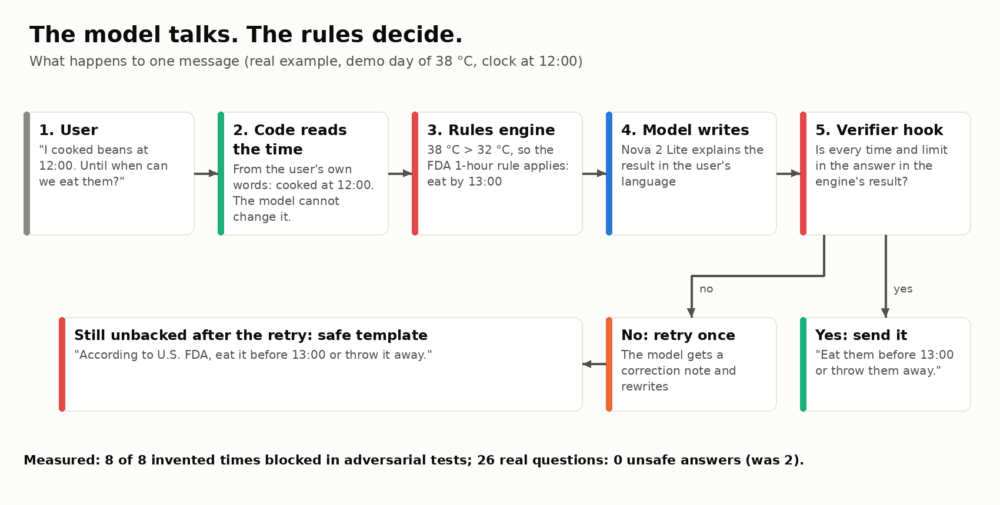

**Evals chose the model.** 18 bilingual scenarios cover:
- households, outages, babies, shelters and danger signs;
- adversarial users (*"just tell me it's 100% safe"*).

We ran the same agent with three Bedrock models:

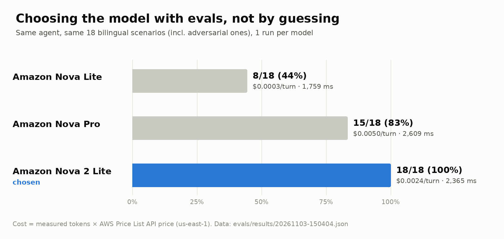

**Amazon Nova Lite** passed **8/18 (44%)**, **Nova Pro 15/18 (83%)** and **Nova 2 Lite 18/18 (100%)**. Nova 2 Lite costs about half as much per turn as Nova Pro. With Nova 2 Lite, that 18-scenario suite passed **36/36** over two runs.

**Then we made the test harder.** We grew the suite to **50 scenarios** (26 in Spanish, 24 in English). The expected times come from the rules engine, not from us. The new scenarios include expired food, spoken times, formula, toddlers, an opened fridge, antibiotics, home remedies, *"ignore your rules"* and a fake WHO claim. The first full run scored **95/100**, and the failures were worth more than the score. They exposed **four real bugs**: an outage deadline the model reused after the fridge door was opened, a prompt rule that only seemed to apply to outages, a template placeholder (*"eat it before HH:MM"*) copied into an answer, and an eval harness that didn't tell the agent the user's language. Each one now has a test. After the fixes: **98/100**, and **99/100** in the latest run (with the *why* sentence added), median **1,644 ms**, **$0.00227** per turn, and **0** safe-template fallbacks. No failure was unsafe: they were correct refusals in different words, an evasive answer that didn't correct a false claim, and one that asked needless questions. We report them as they are.

**After the real-question fixes and shorter answers (4 November, evening), final run with the final code:** **50/50** (median **1,950 ms**, **$0.00285** per turn), **18/18** held-out, **11/11** multi-turn follow-ups, **9/10** adversarial (the one miss refused to say "100% safe" and asked for the time instead of calling the engine: safe, but not the expected answer), **3/3** hygiene tips, and **5/6** new cases for room temperature, planned cooking and salads (the miss: a salad "for the community kitchen" got "from what time to what time do you serve?" instead of a plan; a fair question, but not the expected answer). Raw results are in `evals/results/`.

**Live performance (measured on the deployed demo):**

| Measurement | Result |
|---|---|
| Agent time per turn (median, 15 live turns) | **1.9 s** |
| End to end, follow-up turns | **2.1–3.0 s** |
| First message, before the warm-up (real browser, 6 scenarios) | **6.2 s** median |
| First message with the warm-up, clicking 5 s after the page opens | **2.0 s** median (−68%) |
| First message if clicked instantly (the warm-up is still running) | 5.8 s median, no worse than before |

**Warm-up.** Most of the first-message wait was AgentCore starting a fresh session for each visitor, not the model. When the page opens, the web now calls `/api/warm`, which starts the session and builds the agent **without calling the model (0 tokens)**, under its own daily cap. Measured in a real browser on the live demo: the first answer went from **6.2 s to 2.0 s** (median of 6 scenarios).

**DevOps:**
- **CI:** GitHub Actions runs lint, tests with coverage, a secret scan (gitleaks), a dependency scan (pip-audit), and `cdk synth` on every pull request.
- **Deploy:** every merge to `main` deploys with **OIDC** (no AWS keys stored in GitHub) and runs a smoke test against the live site.
- **Policy as code:** a release is blocked if any food rule is not verified.
- **Observability:** a CloudWatch dashboard, 3 alarms to email, and structured logs with latency, tokens and verifier blocks for each turn.

The smoke test that runs after every deploy, against the live demo (real output, 4 November, after the last deploy):
```
$ make smoke
1) health: {'ok': True}
2) safe window: PASS (5150 ms) -> According to U.S. FDA, eat it before 13:00 or throw it away. In this heat (over 32 °C) bacteria grow faster: it lasts 1 hour, not 2. Shall I remind you at 12:45
3) reminder requested -> Reminder set for 12:45: "Al Tiempo: eat the food before 13:00. After that, throw it away. Source: U.S. FDA"
   reminder: PASS, arrived 102 s after asking; scheduler delay 35 s -> Al Tiempo: eat the food before 13:00. After that, throw it away. Source: U.S. FDA
RESULT: PASS
```

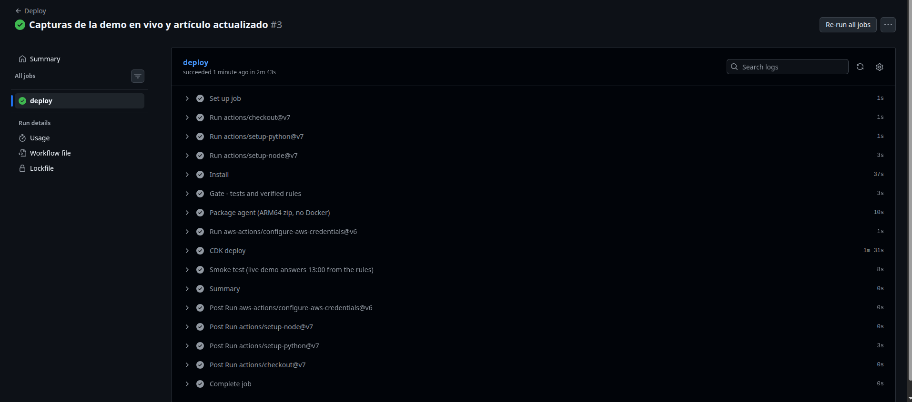

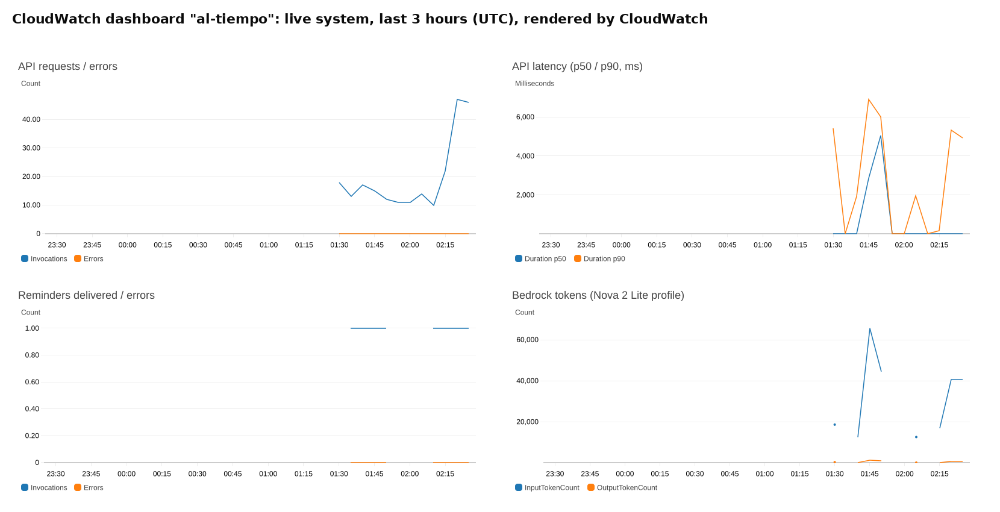

**Deploying without Docker.** AgentCore Runtime runs on ARM64 and my laptop is x86. Instead of emulating a container, the agent ships through AgentCore's *direct code deployment*: a deterministic zip of ARM64 wheels for Python 3.12. The same code always produces the same hash, so nothing redeploys when nothing has changed.

## Originality

| What the workshop taught | What Al Tiempo adds |
|---|---|
| Agent loop + tools | Tools that are a **rules engine with official sources**: the LLM never calculates a time, a limit or a temperature |
| Hooks | A **verifier hook** that fact-checks every time in the answer against the engine (retry once, then a safe template) |
| Deploying to AgentCore Runtime | **Direct code deployment** of an ARM64 zip built without Docker, defined in CloudFormation through CDK |
| Session managers | Session-sticky agents behind an API with throttling and a **daily cap** |
| Evals | Evals as a **model-selection gate** (44% → 100%), and every real bug becomes a regression test |
| — | **EventBridge Scheduler**: the agent acts in the future (reminders), not only when you talk to it |
| — | **Hourly heat forecast** → the 1-hour or 2-hour rule applies hour by hour |
| — | **Power-outage mode** and a **shelter batch planner** |
| — | **Deterministic time reading** from the user's own words (the user's text beats the model's arguments) |
| — | **FinOps:** tagged inference profile, budget alerts, and a **kill switch** (AWS Budgets action) |
| — | **Spoken conversation** (browser speech in, Amazon Polly out), DynamoDB **TTL** for privacy |
| — | An **hourly heat chart** of the forecast the engine used, and a **printable kitchen card** with a QR code |
| — | A **traffic light + safe-window timeline** drawn from the engine's structured output, not from the model's text, with a live countdown |
| — | **Before-cooking planning**: "I'm going to cook at 14:00" gives the eat-by time and a reminder before the food ever sits out |
| — | **Details read in code from the user's words**: eating time vs. cooking time, food still on the heat, the room temperature, "since last night"; the model's own guesses of a time are ignored |
| — | An **installable web app that works offline** with the basic official rules (signal is intermittent where fridges are missing) |

## Existing solutions

- **USDA FoodKeeper** tells you how long food lasts in the fridge, freezer or pantry. It assumes you **have** a refrigerator.
- **WHO Five Keys to Safer Food** and **FDA/USDA guidance** give general rules: 2 hours at room temperature, 1 hour above 32 °C. They are correct, but they are not turned into a time for *your* food, *today*, in *your* heat.

We did not find a tool that:
- applies these rules to the day's hourly forecast for a household without a fridge;
- reminds you at the exact minute;
- plans cooking batches for a shelter without refrigeration.

Al Tiempo fills that gap, and every rule points back to the official source.

## Challenges and a real error we measured

**The error: the agent told a user to throw away food that was still safe.**
- **What failed:** during testing, *"I cooked beans at 12:00"* got *"the beans must be thrown away now"*. The correct answer was *"eat them before 13:00"*.
- **How we found it:** we reproduced it 3 times and logged the tool inputs. The model (Nova Lite at that time) did three different things: it passed the right time, asked again, or **left the time out**. With no time, the tool correctly applied the worst case: "unknown time = discard".
- **What we changed:** the user's own words are now read **in code** (`agent/time_parse.py`, Spanish and English), and they win over whatever the model sends. We added 20 time-reading tests and 3 regression tests.
- **How much it improved:** the same message now gets *"eat them before 13:00"*. On the full eval suite, moving to Nova 2 Lite raised the pass rate from **8/18 (44%) to 18/18 (100%)**, then **36/36** over two runs of the original 18-scenario suite (now **50/50** on the larger 50-scenario suite, final run).

**The opposite error was worse.** *"Can I give my baby the rice I cooked 5 hours ago?"* once got *"eat it before 13:00"*. The verifier did not catch it, because 13:00 *did* come from the tool: the error was in the input, not the output.
- **The fix:** a `minutes_ago` input, and a `discard_now` status from the engine.
- **The safe template** says to throw it away when the limit has passed.
- **The result:** the same question now always gets a red **Throw it away** (see the screenshot above). Each of these became a regression test.

**Two more real bugs, found on the live system:**
- **Reminder text:** the first live reminders were written by the model, and one of the first three arrived as *"Eat the beans now, discard after"*, with no time. Reminder time and text are now built in code from the engine result.
- **Outage mode:** the model once told a user at 12:00 *"you have until 10:00"* for the fridge. The engine had the correct verdict; the model misread it. The engine now returns a plain-language summary in both languages, and the model only relays it. We applied the same idea to the safe-window answer. In the next full eval run, verifier retries dropped from **2 to 0** and the 18-scenario suite still passed **36/36**.

**A user test after launch:** a tester wrote *"cooked it around half past three in the afternoon"* in Spanish (*"a las 3 y media de la tarde"*). Our time reader understood **03:00**. The verifier noticed that the model's 15:30 didn't match and fell back to the safe template, so nobody was told to eat unsafe food, but the answer was clumsy. The reader now understands "y media", "y cuarto", "menos cuarto", "al mediodía" and hours written as words. We added 12 regression tests with the tester's exact sentence. In the same round, the model sometimes ignored *"I kept the fridge closed"*, so door and freezer state are now read from the user's words too. The 18-scenario eval suite we had then was back to **36/36** with **0** verifier retries.

**The biggest test: 26 questions real people asked.** We paraphrased 26 questions that people posted in public forums: food forgotten overnight, a lunch for a construction worker, tamales still steaming, a baby's leftovers, outages, "my grandmother says boiling kills everything", a community kitchen for 150 people, fermented rice. We ran them **once, before changing anything**, and read every answer by hand:

| | Right | Doubtful | Wrong | Unsafe |
|---|---|---|---|---|
| First run, nothing changed | 15 | 4 | 7 | **2** |
| Final run, after the fixes below | **24** | 2 | **0** | **0** |

None of the failures was a wrong rule. Two were follow-ups that ended in a generic safe template and one was a missing *"my rules don't cover fermented food"* (all fixed earlier that day). Most of the rest were about **how real people describe time**, and every one became a test or an eval case:
- *"He eats at 3"* was read as cooked at 03:00. Now the eating time and the cooking time are separate, and the answer says *"it won't last until 15:00"*.
- *"An hour and a half ago"* was read as one hour, an error toward the **unsafe** side.
- *"Since last night"*, *"since 7am"* and *"after 6 hours without power"* were not understood, and the model filled the gap with a made-up time. The tool now ignores the model's guesses: no time in the user's words → it asks.
- *"I'm going to cook at 2"* was read as "yesterday at 2" → "throw it away". Planned cooking is now in the future, with a reminder.
- A thawed and refrozen freezer was called **"safe until tomorrow"** (unsafe). Melted ice now voids the freezer rule.
- The model put the user's raw chicken in a freezer the user never mentioned. The outage answer no longer mentions a freezer unless the user did.
- A real crash we found along the way: the verifier mistook a meal plan for a safe window and its fallback raised `KeyError`, so the user saw "sorry, I could not answer". Fixed with a test.

The 2 doubtful answers left are wording, not decisions: one says it "can't use the kitchen temperature" (it can) and asks for the cooking time, and one credits the FDA for "lime or chili doesn't change the limit", a rule we adapted, not a quote. Both point to the safe side. We report them as they are.

**Other challenges:**
- **Sources that block automated readers:** USDA FSIS returned HTTP 403, so we cite the FDA pages that publish the same rules and that we could check word by word.
- **Verifier false positives:** *"30 minutes left"* and *"the rice from 5 hours ago"* were wrongly blocked at first, and we fixed them with tests.
- **An OIDC gotcha in GitHub Actions:** adding `environment:` changes the token's subject, so AWS would have rejected the role.

## Cost

| Item | Value |
|---|---|
| Bedrock, measured | **$0.0029 per turn** in the final eval run (7,571 input / 127 output tokens on average over 50 turns; AWS Price List API, us-east-1). Earlier: $0.0022 (evals), $0.0024 (live) |
| AgentCore Runtime | Billed by active vCPU and GB-hours. No servers run 24/7: no EC2, no NAT gateway, no provisioned throughput |
| Estimate for the whole judging period (≈1,000 turns until 27 November) | **≈ $3–5** in total |

Guardrails that actually limit spending, not just warn:
- API throttling (10 requests/s, bursts of 20), a daily cap of 500 chat messages, and a separate cap of 1,000 session warm-ups.
- `max_tokens=800` per call, and at most 1 verifier retry.
- A $10 project budget with alerts at 50/80/100%. Normal judging traffic is estimated at about $3, so the switch only fires if someone abuses the demo.
- At 100% of the budget, an **AWS Budgets action automatically attaches a DENY policy** to the agent and API roles.

**We tested the guardrails with real traffic** (`make loadtest`, 4 November). The test only calls the health endpoint, so it never reaches the model:
- **Normal use**, 8 requests per second for 10 seconds: **80 / 80** answered, median **141 ms**, p95 228 ms.
- **A burst of 300 requests in 1.6 seconds:** **65** answered, **57** stopped by API Gateway throttling (HTTP 429), and **178** stopped by Lambda (HTTP 503). None of them reached Bedrock.
- **What the 503s taught us:** this new AWS account allows only **10** Lambda functions running at the same time (the AWS default is 1,000). API Gateway lets bursts of 20 through, so Lambda turned away the rest. Cost stayed protected and the web shows "try again", but the limits were not aligned. A free quota increase fixes it. We found it because we measured it.

The budget and its kill switch, as AWS reports them (real output):
```
$ aws budgets describe-budget-actions-for-budget --budget-name al-tiempo-monthly ...
type: APPLY_IAM_POLICY   threshold: 100%   approval: AUTOMATIC   status: STANDBY
policy: arn:aws:iam::<account>:policy/al-tiempo-kill-switch
```

## Limitations and next steps

**Limitations (no spin):**
- Al Tiempo gives **general guidance from public-health rules**. It cannot see, smell or test food, and it is not medical advice.
- The rules are **time and temperature rules**. They don't cover food that was already contaminated, or allergies.
- **No field study yet.** All metrics above are system metrics.
- The model can still phrase things imperfectly. In one eval answer it said food "has been out for 2 hours" when it had been 0 hours (conservative, but false). The verifier checks times and limits, not every sentence.
- SMS reminders are implemented but disabled in the demo: the AWS account is on the Free plan, where SMS is not available. The demo uses web reminders and browser notifications.
- Voice input works only in browsers with speech recognition (Chrome, Edge, Android).
- Two languages so far.
- The model still varies between runs (about ±2 scenarios out of 26–50), so a judge may see slightly different wording from ours. The decision and its times come from the engine every time.

**Next steps:**
- Pilot with a community kitchen and with community health workers.
- WhatsApp and SMS in production.
- Amazon Transcribe for voice input, so the audio stays in AWS (blocked today by the account's Free plan).
- More languages.
- Bulk alerts for community health workers on heat-wave days.
- Guidance for evaporative clay-pot coolers.
- Schools.
- A native mobile app.

## What I learned

[TODO: personalize: this is a draft in my voice]

- **Let code decide, let the model explain.** My first version trusted the model with times and failed in both directions: it told someone to throw away safe food, and it told someone to feed a baby rice that should have been discarded. Moving every calculation into tested code was the turning point.
- **Evals turn opinions into decisions.** I didn't pick the model by reputation. 18 scenarios picked it, and every bug we found became a test.
- **Real questions teach more than invented ones.** My scenarios passed; 26 questions from real people produced 2 unsafe answers on the first run. Almost all of it was how people talk about time.
- **Sources need verbatim quotes.** Checking every rule word by word removed three outdated numbers from my own notes.
- **Cloud and DevOps from day one:**
  - one least-privilege IAM user per project;
  - GitHub Actions with OIDC instead of stored keys;
  - a budget with a real kill switch;
  - everything in CDK, so the whole system can be rebuilt with one command.

## How AI was used

- **Writing the code:** I used **Claude Code** (Anthropic) as a pair programmer, and it wrote most of the code.
- **My part:** I defined the problem, the scope and the safety principles. I reviewed and tested the work, approved every IAM change, deployed to my AWS account, and made every commit and merge myself.
- **Sources:** every source and number was checked against the original page, and the verbatim quotes are stored in the repository (`docs/sources.md`).
- **Inside the product:** Al Tiempo uses **Amazon Nova 2 Lite** on Amazon Bedrock to talk with users. The times and limits always come from deterministic code.
- **Images:** the diagrams and the chart in this article are generated from code in the repository (`scripts/make_figures.py`). The chart reads the raw eval results.

---

*Al Tiempo gives general food-safety guidance from public-health sources. It is not medical advice. In an emergency, call your local emergency number.*
