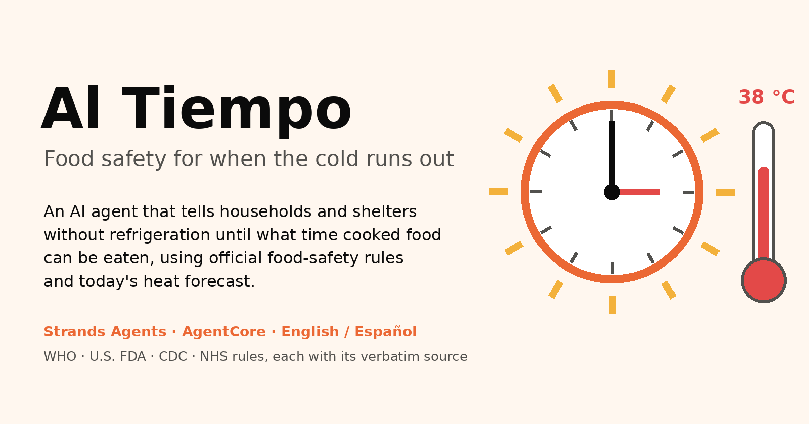
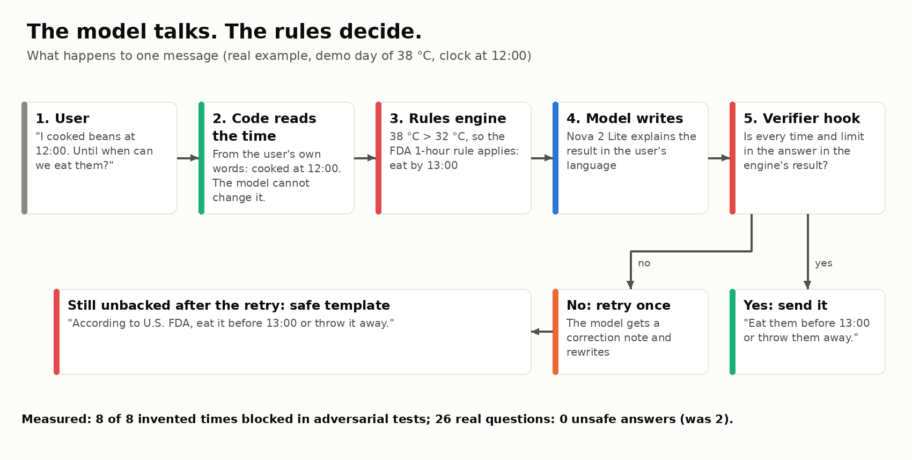
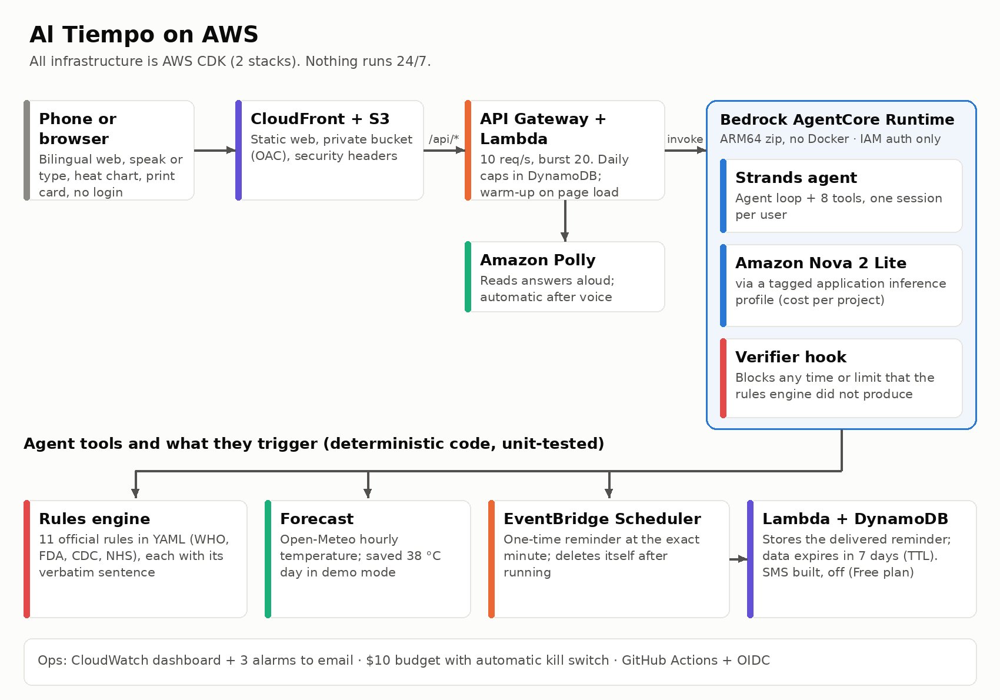
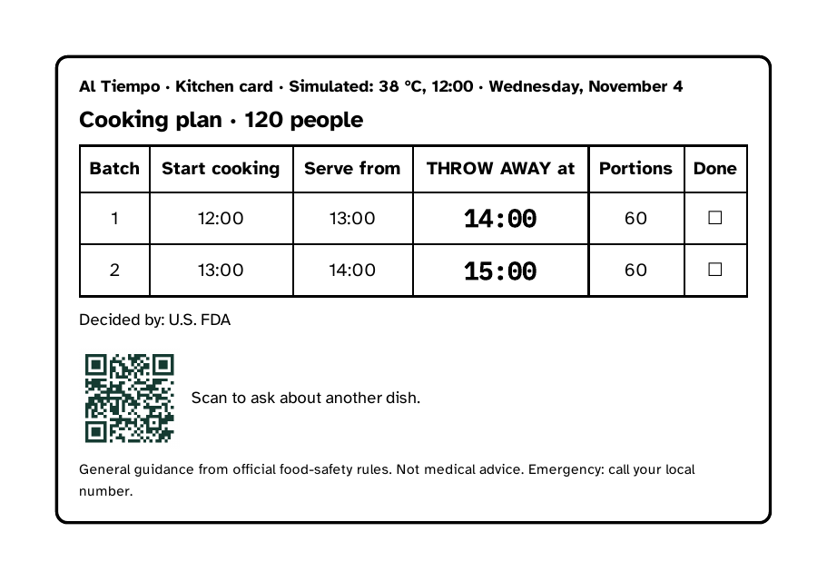
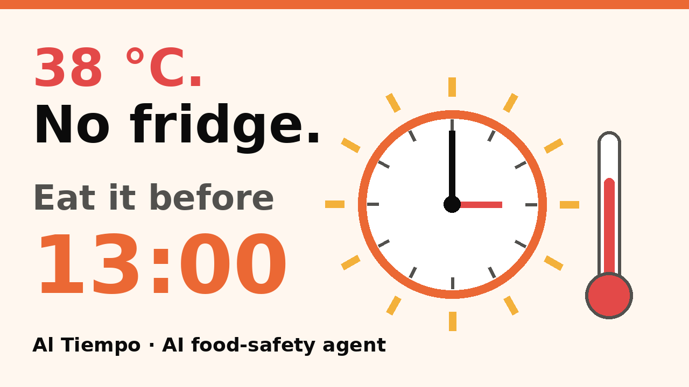

# Guion del video (< 3 min) — Al Tiempo

Reglas: menos de 3:00 (los jueces no ven más), público en YouTube, **subtítulos en inglés**, sin música con
copyright y **sin logos ni marcas de terceros** (OMS, FDA, CDC, NHS, USDA, FoodKeeper…): las fuentes se dicen o se
escriben en texto, nunca con su logo. Si grabas la consola de AWS o GitHub, que no sea el foco de la toma.

**Graba en Chrome** (celular Android o Chrome de escritorio en modo celular con F12 → 📱): el micrófono solo
aparece en Chrome, Edge y Android. La voz puede ser tuya en inglés, o en español con subtítulos en inglés.

Todas las cifras de abajo están medidas o tienen fuente (`docs/metrics.md`, `docs/sources.md`).
Miniatura para YouTube: [img/thumbnail-video.png](img/thumbnail-video.png) (abajo).

| Tiempo | En pantalla | Voz / subtítulo (inglés) |
|---|---|---|
| 0:00–0:12 | Imagen **A** (portada) o texto: "38 °C. No fridge. Rice cooked at 9:00." | "A mother cooked rice at nine. It's 38 degrees and she has no fridge. Is it still safe for her child? Every year, 866 million people get sick from unsafe food, according to the WHO." |
| 0:12–0:40 | Demo en **inglés**. Toca 🎤 **Speak** y di: *"I'm going to cook beans at two in the afternoon. Until when can we eat them?"* → aparece el **semáforo verde 15:00** → se oye la respuesta (Polly) | "Al Tiempo helps before the food sits out. I just ask out loud. It answers with a clock time, not a guess — eat it before three — and reads it back, for people who read little." |
| 0:40–0:55 | Baja a **"Today's heat, hour by hour"** (la curva con la línea de 32 °C) | "Why one hour and not two? Today's forecast goes above 32 degrees, so the official FDA rule drops from two hours to one. You can see it." |
| 0:55–1:10 | Escribe *"Yes, please remind me"* → corta la espera → aparece ⏰ **Reminder** | "It schedules a reminder for the exact minute with Amazon EventBridge Scheduler, even if you close the app. In the demo the clock is accelerated." |
| 1:10–1:25 | Escribe: *"I cooked stew at 11, the room has air conditioning at 22 degrees"* → respuesta | "It listens to real details: in a 22-degree room the limit is two hours — and never more." |
| 1:25–1:40 | Botón **Shelter (120 people)** → plan de tandas → **Print card** → la tarjeta impresa (imagen **D**) | "For shelters after a disaster, it plans cooking batches so nothing is served past its time — and prints a card for the kitchen wall." |
| 1:40–1:50 | Rápido: arroz de hace 5 horas → **rojo "Throw it away"**; luego **Danger signs** | "If it's too late, it says so plainly. If a child shows danger signs: go to a clinic now. No diagnosis, no doses." |
| 1:50–2:20 | Imagen **B** (verificador), luego imagen **C** (arquitectura) | "The model talks; the rules decide. The language model never calculates a time. A tested rules engine does, with eleven official rules verified word by word. A verifier hook blocks any time the engine didn't produce. It runs on Strands Agents and Amazon Bedrock AgentCore, built with CDK and GitHub Actions." |
| 2:20–2:45 | Texto en pantalla: "26 real questions · right answers 15 → 24 · unsafe 2 → 0" y luego la terminal con `make smoke` → `RESULT: PASS` | "We tested it with 26 questions real people asked online. At first, 15 were right and 2 were unsafe. We fixed what we learned: now 24 are right and none is unsafe. 50 of 50 evaluation scenarios pass, and each answer costs about three tenths of a cent." |
| 2:45–3:00 | La demo + link | "Next: a pilot with a community kitchen, and SMS and voice in AWS. Try it in one minute, no login, at the link below." |

## Imágenes para el video
Ábrelas a pantalla completa (o arrástralas a tu editor de video) en la escena que indica la tabla.

**A. Portada** (0:00–0:12) — [img/cover.png](img/cover.png)

**B. Verificador** (1:50–2:05) — [img/verifier.png](img/verifier.png)

**C. Arquitectura** (2:05–2:20) — [img/architecture.png](img/architecture.png)

**D. Tarjeta impresa del albergue** (1:25–1:40) — [capturas/ui/live-print-card-shelter-en.png](capturas/ui/live-print-card-shelter-en.png)

**Miniatura de YouTube** — [img/thumbnail-video.png](img/thumbnail-video.png)

## Antes de grabar
- Usa una ventana de incógnito (sesión nueva) y espera ~5 s antes del primer mensaje: así el primero tarda ~2 s.
- La primera vez que tocas 🎤, Chrome pide permiso del micrófono: acéptalo antes de grabar.
- Si el audio de la respuesta no suena solo (algunos navegadores lo bloquean), toca **🔊 Listen**.
- Graba cada escena por separado y júntalas; recorta las esperas (deja ver que el recordatorio llega).
- Para la tarjeta impresa: **Print card** → en la vista previa de impresión, graba la hoja (no hace falta imprimir).
- Subtítulos: pega la columna de voz en YouTube Studio → Subtítulos → inglés.
- Descripción de YouTube: link de la demo, link del repo, y "Built with Strands Agents on AWS. Code written with the help of Claude Code. Weather data by Open-Meteo.com (CC BY 4.0)."
- Al terminar, pásame el link y lo pongo en el artículo y en el README.
